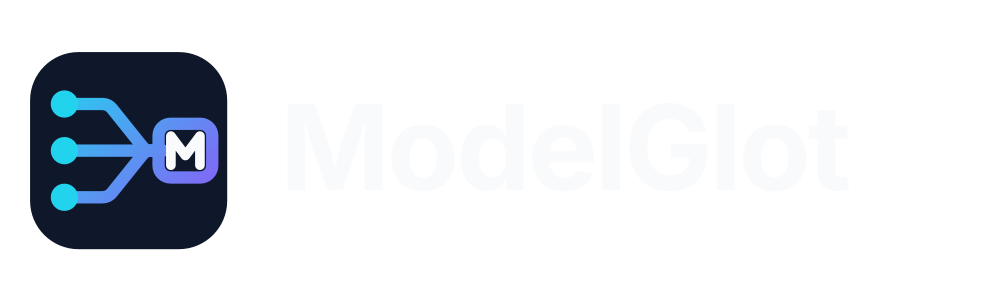
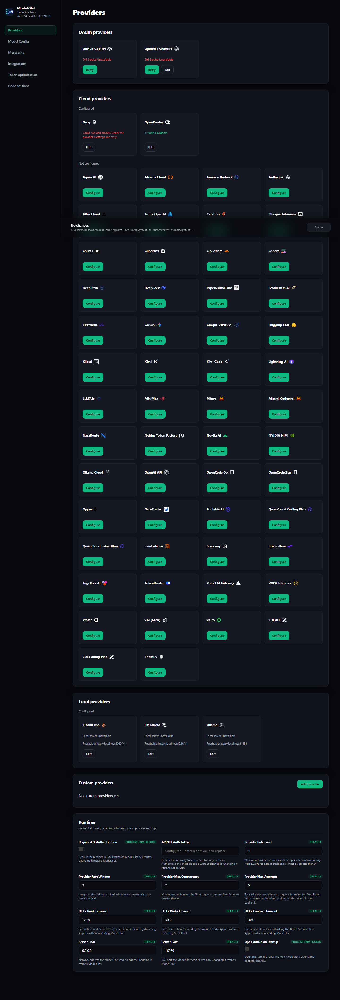
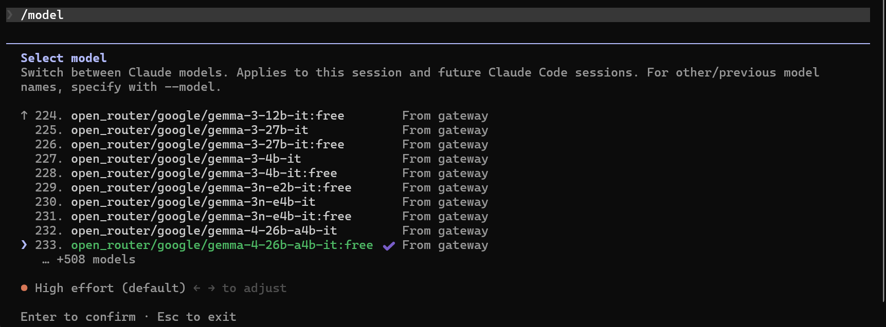
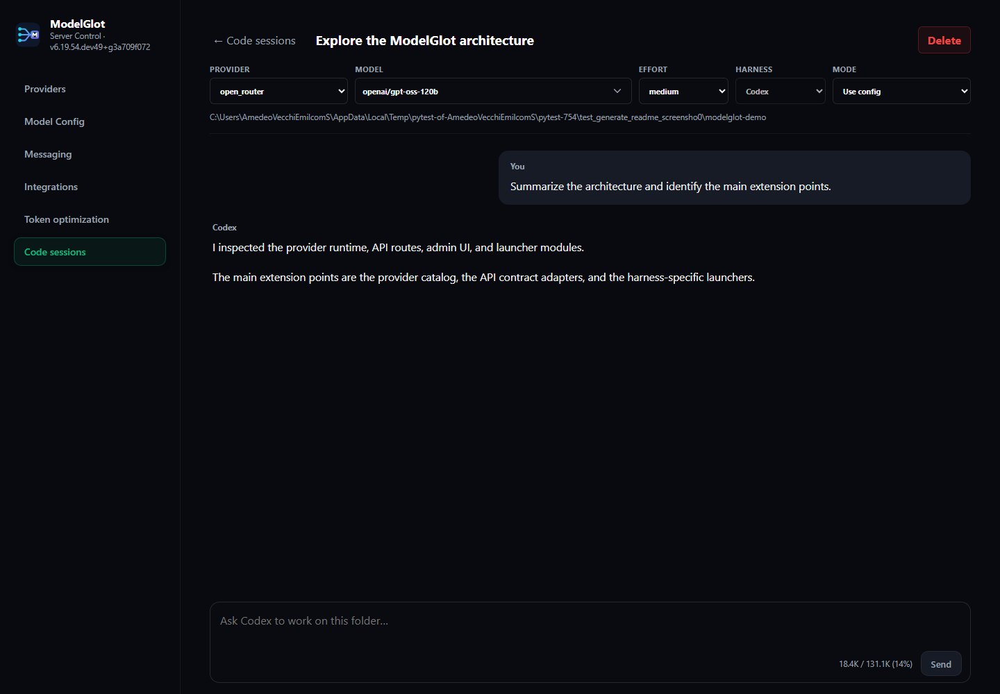
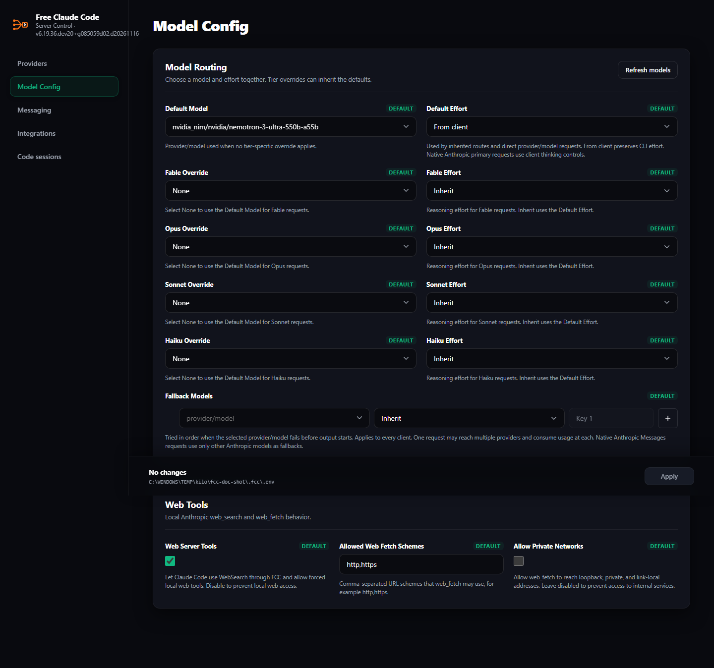
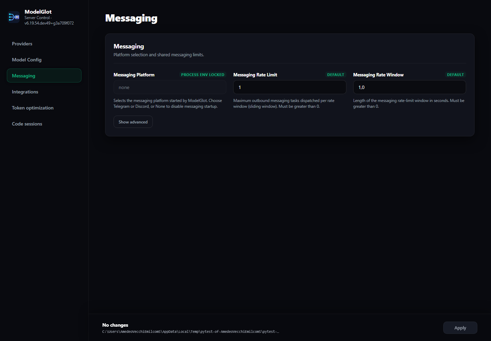

<div align="center">

<h1>
  <picture>
    <source media="(prefers-color-scheme: light)" srcset="assets/modelglot-wordmark-light.svg">
    
  </picture>
</h1>

<p><strong>One local control plane for your coding agents and your AI models.</strong></p>
<p>Use Claude Code, Codex, OpenCode, VS Code and 8 other harnesses with 61 providers —
free, paid, subscription and local — without changing how you work.</p>

[](LICENSE)
[](https://www.python.org/downloads/)


[Quick Start](#quick-start) · [What ModelGlot adds](#what-modelglot-adds-to-upstream) · [Providers](#choose-a-provider) · [Code sessions](#code-sessions) · [Integrations](#integrations) · [API](#use-the-api-directly) · [Phone](#use-from-your-phone) · [Manage](#manage-your-installation)

</div>

<p align="center">
  <em>Independent open-source project based on an upstream open-source codebase.
  Not affiliated with or endorsed by Anthropic, OpenAI or Google.
  Claude and Claude Code are trademarks of Anthropic.</em>
</p>

## What ModelGlot Is

ModelGlot runs on your computer and sits between your coding agent and the model
provider. Your agent talks to ModelGlot, ModelGlot translates the request into the
provider's protocol, and the answer comes back with native streaming, tool calls
and thinking blocks intact.

In practice this means:

- **You keep your tools.** Claude Code, Codex, OpenCode, Cline, Pi, Hermes,
  DeepSeek Harness, Grok Build, Muse Code, Aider, Antigravity CLI and VS Code Chat
  all work the way they always did.
- **You keep your workflow.** Credentials, model choice, reasoning effort, fallback
  order and rate limits live in one local Admin UI.
- **You choose the model.** 61 providers, including local Ollama, LM Studio and
  llama.cpp servers, plus free and paid cloud models.
- **You stay in control.** The proxy, the Admin UI and the local database stay on
  your machine; you decide what is exposed to the network.

<div align="center">
  
  <p><em>Claude Code running through ModelGlot.</em></p>
</div>

## What ModelGlot Adds To Upstream

ModelGlot keeps the upstream core — the harnesses, the provider catalog, the four
API protocols and the routing engine — and adds its own identity, its own
observability and a set of product improvements.

| Area | ModelGlot |
| --- | --- |
| **Own identity and state** | `modelglot-*` commands, `~/.modelglot` state, port `16969`, branded desktop app, tray, notifications and icons. Nothing collides with an upstream installation. |
| **Readable model catalog** | Descriptive titles, provider logos, capability badges, context limits, release state, provenance and freshness in the picker — while every canonical model ID and route stays unchanged. |
| **Token optimization and usage dashboard** | A read-only Admin page that shows RTK and Headroom reports, provider-observed usage per model/provider/day, and Code session context occupancy — each with its own basis, never merged into one number. |
| **Guided desktop experience** | Check for updates from the tray, install a stable release and reopen automatically, with branded native notifications and update logs. |
| **Claude Desktop 3P profile** | A ModelGlot-owned profile that prefers 1M context for compatible models and registers Anthropic's official plugin marketplaces. |
| **Clearer Admin UI** | Runtime settings now explain their unit, their effect and when a restart is needed; sections adapt to your platform and your configured providers. |
| **Cleaner interruptions** | `Ctrl+C` closes the native client and its launcher with exit code 130 and no Python traceback; the local proxy keeps running. |
| **Safer new data paths** | Admin routes stay loopback-only with `Cache-Control: no-store`; the usage schema stores no prompts, completions, tool arguments or credentials; CSV export neutralizes formula injection. |

> **Switching from the upstream project?** ModelGlot deliberately does **not**
> import legacy state, commands or environment variables. Configure your providers
> again and point your clients at `http://127.0.0.1:16969`.

Code sessions and local web tools (`web_search` / `web_fetch`) already existed
upstream: ModelGlot keeps them and documents them properly
([Code sessions](#code-sessions), [`docs/code-sessions.md`](docs/code-sessions.md),
[`docs/web-tools.md`](docs/web-tools.md)).

## Quick Start

<a id="install"></a>

### 1. Install

macOS/Linux:

```bash
curl -fsSL "https://raw.githubusercontent.com/amedeo82/ModelGlot/main/scripts/install.sh" | sh -s -- --ref main
```

Windows PowerShell:

```powershell
& ([scriptblock]::Create((irm "https://raw.githubusercontent.com/amedeo82/ModelGlot/main/scripts/install.ps1"))) -Ref main
```

These commands install the current commit from the `main` branch. The installed
version includes the VCS build identifier; run `modelglot-server --version` to
display it.

When prompted, choose at least one coding agent and optionally enable
[RTK](https://github.com/rtk-ai/rtk) + [Headroom](https://github.com/headroomlabs-ai/headroom)
token optimization for supported agents.

<details>
<summary><strong>Installer options</strong></summary>

| macOS/Linux | Windows | Effect |
| --- | --- | --- |
| `--ref REF` | `-Ref REF` | Install from a branch or tag. The commands above use `main`. |
| `--rtk-headroom` | `-RtkHeadroom` | Install and configure RTK + Headroom without the interactive prompt. |
| `--voice-local` | `-VoiceLocal` | Install local Whisper transcription support. |
| `--torch-backend VALUE` | `-TorchBackend VALUE` | Select a uv PyTorch backend, such as `cu130`. Requires local voice. |
| `--update` | `-Update` | Skip when the installed ModelGlot version is already current. |
| `--dry-run` | `-DryRun` | Print the installation commands without changing the system. |

</details>

### 2. Start ModelGlot

#### Windows

Open **ModelGlot** from your desktop or Start menu.

#### macOS

Open **ModelGlot** from your desktop or Applications folder.

#### Linux

Run:

```bash
modelglot-server
```

ModelGlot opens the Admin UI after starting. On Windows and macOS, use the tray or
menu-bar icon to open Admin, check the server status or installed version, check
for project updates, restart, or quit. **Check for Updates** runs the release
check in the background and shows the installed and latest stable versions in a
native notification and in the tray menu. If an update is available, ModelGlot asks
for confirmation before closing, installing it, and reopening. When using
`modelglot-server`, keep its terminal open.

> **Network exposure:** the current defaults bind the server to `0.0.0.0` and leave
> Proxy Authentication disabled, so generation endpoints are reachable from other
> hosts on the local network. On a shared or untrusted network, set
> `MODELGLOT_HOST=127.0.0.1` or enable Proxy Authentication in Admin before using
> configured provider credentials. The Admin API and UI remain restricted to
> loopback callers.

### 3. Add A Provider

1. Open the Admin UI URL from the server log.
2. Open **Providers** and click **Add key** on the provider you want to use.
3. Paste the key and click **Save**.
4. Open **Model Config**, search the `MODEL` dropdown and select a model.
5. Click **Apply**.

For example, to start with NVIDIA NIM: create an API key at
[build.nvidia.com/settings/api-keys](https://build.nvidia.com/settings/api-keys),
then leave `MODEL` on the default
`nvidia_nim/nvidia/nemotron-3-ultra-550b-a55b` or pick another model from the
dropdown.

To protect the local proxy with a bearer token, enable **Proxy Authentication**
in Admin.

<div align="center">
  
  <p><em>The ModelGlot Admin UI: providers, local providers, custom providers and runtime settings.</em></p>
</div>

### 4. Run Your Coding Agent

| Agent | Command | Agent | Command |
| --- | --- | --- | --- |
| Claude Code | `modelglot-claude` | Hermes | `modelglot-hermes` |
| Codex | `modelglot-codex` | DeepSeek Harness Web | `modelglot-dsh` |
| Pi | `modelglot-pi` | Grok Build | `modelglot-grok` |
| OpenCode 2 | `modelglot-opencode` | Muse Code | `modelglot-muse` |
| Cline | `modelglot-cline` | Aider | `modelglot-aider` |
| Antigravity CLI | `modelglot-agy` | VS Code Chat | [Connect](#integrations) |

Pressing `Ctrl+C` while a native client is running exits that client and its
ModelGlot launcher cleanly, without a Python traceback. The local ModelGlot proxy
keeps running and remains available for the next client session.

Other clients and SDKs can call ModelGlot directly.
See [Use The API Directly](#use-the-api-directly).

<a id="model-picker"></a>

<div align="center">
  
  <p><em>Select a ModelGlot model from Claude Code's native <code>/model</code> picker.</em></p>
</div>

<a id="code-sessions"></a>

## Code Sessions

ModelGlot includes a browser workspace for running Codex against a local project
folder. Open **Admin UI → Code sessions**, select **New code session**, and choose an
existing folder or enter its absolute path. Each session persists its title, model,
reasoning effort, permission mode, turns and transcript in ModelGlot's local SQLite
database.

Codex must be installed separately and available on `PATH`:

```bash
npm install -g @openai/codex
```

The session controls include the provider, model, reasoning effort and Codex
permission mode: **Use config**, **Ask**, **Auto-review** or **Full access**. The
browser receives live turn and tool events over Server-Sent Events. Use **Stop** to
cancel the active turn and **Delete** to remove both the ModelGlot session and its
native Codex conversation.

<div align="center">
  
  <p><em>A native Codex session in ModelGlot's browser UI.</em></p>
</div>

See [`docs/code-sessions.md`](docs/code-sessions.md) for the complete workflow,
Admin API and current limitations.

## Choose A Provider

1. Open a provider link below for its key, models or setup instructions.
2. In the Admin UI, configure the listed setting. For OpenAI / ChatGPT
   subscription access, use **Providers → OAuth providers** instead.
3. Search the `MODEL` dropdown and select a model. If the provider cannot list
   models, enter `<provider-id>/<exact-provider-model-id>` manually.
4. Click **Apply**.

Optional: add an ordered **Fallback Models** list under **Model Config**. It
applies to every connected client. A failed request may reach and consume usage
from more than one provider before succeeding.

Provider modals support numbered API keys. Use **Add key**, remove rows, or drag
their handles to reorder them. The primary route always uses key 1; to try another
key, add the same model to **Fallback Models** and select the desired key number.

For another API endpoint, open **Providers → Custom providers → Add provider**.
Enter its API base URL, optional keys, and API format. Leave **Model IDs** empty to
discover models automatically, or enter one upstream model ID per line. Save, then
select a model in **Model Config**.

<details>
<summary><strong>Provider catalog (61 providers)</strong></summary>

| Provider | Admin UI setting | Example `MODEL` |
| --- | --- | --- |
| [NVIDIA NIM](https://build.nvidia.com/settings/api-keys) | `NVIDIA_NIM_API_KEY` | `nvidia_nim/nvidia/nemotron-3-ultra-550b-a55b` |
| [OpenRouter](https://openrouter.ai/keys) | `OPENROUTER_API_KEY` | `open_router/openrouter/free` |
| [Groq](https://console.groq.com/keys) | `GROQ_API_KEY` | `groq/llama-3.3-70b-versatile` |
| [ClinePass](https://docs.cline.bot/getting-started/clinepass) | `CLINE_API_KEY` | `cline_pass/cline-pass/kimi-k3` |
| [OpenAI / ChatGPT](https://learn.chatgpt.com/docs/auth) | Connect ChatGPT in the Admin UI | `openai/<model-id>` |
| [OpenAI API](https://platform.openai.com/api-keys) | `OPENAI_API_KEY` | `openai_api/gpt-5.6-sol` |
| [GitHub Copilot](https://docs.github.com/en/copilot/how-tos/copilot-sdk/auth/authenticate) | Connect GitHub Copilot in the Admin UI | `github_copilot/<model-id>` |
| [xAI (Grok)](https://console.x.ai/team/default/api-keys) | `XAI_API_KEY` | `xai/grok-4.5` |
| [Alibaba Cloud](https://www.alibabacloud.com/help/en/model-studio/get-api-key) | `ALIBABA_CLOUD_API_KEY` | `alibaba_cloud/<model-id>` |
| [QwenCloud Token Plan](https://home.qwencloud.com/api-keys) | `QWENCLOUD_API_KEY` | `qwencloud/qwen3.7-plus` |
| [QwenCloud Coding Plan](https://home.qwencloud.com/api-keys) | `QWENCLOUD_CODING_API_KEY` | `qwencloud_coding/qwen3.7-plus` |
| [Together AI](https://api.together.ai/settings/api-keys) | `TOGETHER_API_KEY` | `together/zai-org/GLM-5.2` |
| [DeepInfra](https://deepinfra.com/dash/api_keys) | `DEEPINFRA_API_KEY` | `deepinfra/deepseek-ai/DeepSeek-V4-Flash` |
| [SiliconFlow](https://cloud.siliconflow.com/account/ak) | `SILICONFLOW_API_KEY` | `siliconflow/Qwen/Qwen3-32B` |
| [Nebius Token Factory](https://tokenfactory.nebius.com/project/api-keys) | `NEBIUS_API_KEY` | `nebius/Qwen/Qwen3-30B-A3B` |
| [Chutes](https://chutes.ai/docs/getting-started/authentication) | `CHUTES_API_KEY` | `chutes/Qwen/Qwen3-32B-TEE` |
| [Featherless AI](https://featherless.ai/account/api-keys) | `FEATHERLESS_API_KEY` | `featherless/Qwen/Qwen3-32B` |
| [Agnes AI](https://agnes-ai.com/) | `AGNES_API_KEY` | `agnes/agnes-2.0-flash` |
| [ZenMux](https://zenmux.ai/platform/pay-as-you-go) | `ZENMUX_API_KEY` | `zenmux/deepseek/deepseek-v4-flash-free` |
| [W&B Inference](https://wandb.ai/settings) | `WANDB_API_KEY` | `wandb/openai/gpt-oss-20b` |
| [Anthropic](https://platform.claude.com/settings/keys) | `ANTHROPIC_API_KEY` | `anthropic/<model-id>` |
| [Azure OpenAI](https://learn.microsoft.com/azure/foundry/openai/how-to/chatgpt) | `AZURE_OPENAI_API_KEY` and `AZURE_OPENAI_BASE_URL` | `azure_openai/<deployment-name>` |
| [Google AI Studio (Gemini)](https://aistudio.google.com/apikey) | `GEMINI_API_KEY` | `gemini/models/gemini-3.1-flash-lite` |
| [Google Vertex AI](https://cloud.google.com/vertex-ai/generative-ai/docs/start/openai) | `VERTEX_PROJECT_ID` + ADC | `vertex/google/gemini-3.5-flash` |
| [DeepSeek](https://platform.deepseek.com/api_keys) | `DEEPSEEK_API_KEY` | `deepseek/deepseek-chat` |
| [Mistral La Plateforme](https://console.mistral.ai/) | `MISTRAL_API_KEY` | `mistral/devstral-small-latest` |
| [Mistral Codestral](https://console.mistral.ai/) | `CODESTRAL_API_KEY` | `mistral_codestral/codestral-latest` |
| [OpenCode Zen](https://opencode.ai/auth) | `OPENCODE_API_KEY` | `opencode_zen/gpt-5.3-codex` |
| [OpenCode Go](https://opencode.ai/auth) | `OPENCODE_API_KEY` | `opencode_go/minimax-m2.7` |
| [Vercel AI Gateway](https://vercel.com/docs/ai-gateway/models-and-providers) | `AI_GATEWAY_API_KEY` | `vercel/openai/gpt-5.5` |
| [Amazon Bedrock](https://console.aws.amazon.com/bedrock/) | `AWS_BEARER_TOKEN_BEDROCK` | `bedrock/openai.gpt-oss-120b` |
| [Hugging Face Inference Providers](https://huggingface.co/settings/tokens) | `HUGGINGFACE_API_KEY` | `huggingface/Qwen/Qwen3-Coder-480B-A35B-Instruct:fastest` |
| [Cohere](https://dashboard.cohere.com/api-keys) | `COHERE_API_KEY` | `cohere/command-a-plus-05-2026` |
| [Wafer](https://wafer.ai/) | `WAFER_API_KEY` | `wafer/DeepSeek-V4-Pro` |
| [Kimi API](https://platform.moonshot.ai/console/api-keys) | `KIMI_API_KEY` | `kimi/kimi-k2.5` |
| [Kimi Code](https://www.kimi.com/code/console) | `KIMI_CODE_API_KEY` | `kimi_code/k3` |
| [MiniMax](https://platform.minimax.io/user-center/basic-information/interface-key) | `MINIMAX_API_KEY` | `minimax/MiniMax-M3` |
| [Cerebras Inference](https://cloud.cerebras.ai/) | `CEREBRAS_API_KEY` | `cerebras/gpt-oss-120b` |
| [SambaNova](https://cloud.sambanova.ai/apis) | `SAMBANOVA_API_KEY` | `sambanova/Meta-Llama-3.3-70B-Instruct` |
| [Kilo.ai](https://kilo.ai) | `KILO_API_KEY` | `kilo/kilo-auto/free` |
| [Fireworks AI](https://fireworks.ai/account/api-keys) | `FIREWORKS_API_KEY` | `fireworks/accounts/fireworks/models/llama-v3p3-70b-instruct` |
| [Novita AI](https://novita.ai/settings/key-management) | `NOVITA_API_KEY` | `novita/deepseek/deepseek-v4-flash-0731` |
| [Cloudflare Workers AI](https://developers.cloudflare.com/workers-ai/) | `CLOUDFLARE_API_TOKEN` and `CLOUDFLARE_ACCOUNT_ID` | `cloudflare/@cf/moonshotai/kimi-k2.6` |
| [Z.ai Coding Plan](https://z.ai/manage/apikey/apikey-list) | `ZAI_API_KEY` | `zai/glm-5.2` |
| [Z.ai API (pay as you go)](https://z.ai/manage/apikey/apikey-list) | `ZAI_API_KEY` | `zai_api/glm-4.7-flash` |
| [TokenRouter](https://www.tokenrouter.com/) | `TOKENROUTER_API_KEY` | `tokenrouter/moonshotai/kimi-k3-free` |
| [NaraRoute](https://router.bynara.id/) | `NARAROUTE_API_KEY` | `nararoute/kimi-k3-free` |
| [Poolside AI](https://platform.poolside.ai/) | `POOLSIDE_API_KEY` | `poolside/poolside/laguna-s-2.1` |
| [LLM7.io](https://dash.llm7.io/) | `LLM7_API_KEY` | `llm7/default` |
| [Scaleway](https://console.scaleway.com/iam/api-keys) | `SCW_SECRET_KEY` | `scaleway/deepseek/deepseek-v4-flash` |
| [Lightning AI](https://lightning.ai/) | `LIGHTNING_API_KEY` | `lightning/lightning-ai/Qwen3.8-27B` |
| [Experiential Labs](https://platform.experientiallabs.ai/) | `EXPLABS_API_KEY` | `experiential/union-alpha` |
| [Cheaper Inference](https://cheaperinference.com/signup) | `CHEAPER_INFERENCE_API_KEY` | `cheaperinference/gpt-5.4-mini` |
| [OrcaRouter](https://www.orcarouter.ai/) | `ORCAROUTER_API_KEY` | `orcarouter/deepseek/deepseek-v4-flash-free` |
| [Atlas Cloud](https://console.atlascloud.ai/api-keys) | `ATLASCLOUD_API_KEY` | `atlascloud/deepseek-ai/deepseek-v4-flash` |
| [xKiro](https://xkiro.com/) | `XKIRO_API_KEY` | `xkiro/qwen/qwen3.7-flash:free` |
| [Opper](https://platform.opper.ai/) | `OPPER_API_KEY` | `opper/claude-sonnet-4-6` |
| [Ollama Cloud](https://ollama.com/settings/keys) | `OLLAMA_API_KEY` | `ollama_cloud/qwen3-coder:480b` |
| [LM Studio](https://lmstudio.ai/) | `LM_STUDIO_BASE_URL` | `lmstudio/<model-id>` |
| [llama.cpp](https://github.com/ggml-org/llama.cpp) | `LLAMACPP_BASE_URL` | `llamacpp/<model-id>` |
| [Ollama](https://ollama.com/) | `OLLAMA_BASE_URL` | `ollama/<model-tag>` |

</details>

<details>
<summary><strong>Provider-specific setup</strong></summary>

- OpenAI / ChatGPT uses your ChatGPT subscription rather than an API key. Connect from
  **Providers → OAuth providers → OpenAI / ChatGPT → Connect** in the Admin UI
  and finish signing in through your browser. Restart an already-running agent after connecting.
- Anthropic uses a separately billed API key. Add it under
  **Providers → Cloud providers → Anthropic → Configure**, then choose a discovered
  model. Multi-workspace keys also require `ANTHROPIC_WORKSPACE_ID`.
- OpenAI API uses a separate Platform API key. Enter it under
  **Providers → Cloud providers → OpenAI API → Configure**. The model list may
  include IDs that cannot handle coding requests. Choose a text-generation model.
- GitHub Copilot uses your signed-in GitHub account and subscription. Install
  [Copilot CLI 1.0.83](https://github.com/github/copilot-cli/releases/tag/v1.0.83)
  on PATH, then choose **Providers → OAuth providers → GitHub Copilot → Connect**.
  Finish signing in, then select a `github_copilot/<model-id>` from the model picker.
  Available models and quotas depend on your subscription and organization policies.
  Restart an already-running agent after connecting.
- Azure OpenAI uses the deployment names from your resource. Set
  `AZURE_OPENAI_BASE_URL` to its complete v1 endpoint, such as
  `https://YOUR-RESOURCE-NAME.openai.azure.com/openai/v1/`, and select a
  deployment that supports Chat Completions. Enter the deployment name as a
  custom model slug if it does not appear in the model dropdown.
- Mistral Codestral uses a separate key from Mistral La Plateforme.
- Kimi Code subscription keys use `kimi_code/`. Kimi API credit keys use
  `kimi/`. Kimi Code plans are for personal interactive coding-agent use under
  [Kimi's community guidelines](https://www.kimi.com/code/docs/en/kimi-code/community-guidelines.html).
- Alibaba Cloud uses a Model Studio pay-as-you-go key and defaults to Singapore.
  For another region or workspace, set `ALIBABA_CLOUD_BASE_URL` to its
  [OpenAI-compatible endpoint](https://www.alibabacloud.com/help/en/model-studio/base-url)
  ending in `/compatible-mode/v1`. The key and endpoint must use the same region.
- QwenCloud Coding Plan keys use `qwencloud_coding/`. QwenCloud Token Plan keys
  use `qwencloud/`. The keys and endpoints are not interchangeable. Coding Plan
  is for local, personal, interactive coding-agent use under the
  [Coding Plan terms](https://www.alibabacloud.com/help/en/model-studio/coding-plan).
- OpenCode Zen and OpenCode Go share `OPENCODE_API_KEY` but use the explicit
  `opencode_zen/` and `opencode_go/` model prefixes.
- For Amazon Bedrock, set `BEDROCK_BASE_URL` to the URL for the same region as
  the API key and select one of the listed models.
- Vertex AI uses Google Application Default Credentials instead of an API key.
  Locally, run `gcloud auth application-default login` once. Service-account
  files and attached service accounts also work. Set `VERTEX_PROJECT_ID`, and
  optionally change `VERTEX_LOCATION` from its `global` default.
- Cloudflare requires both its API token and account ID.
- For Ollama Cloud, use the exact model IDs shown in the model picker. Local
  Ollama uses the separate `ollama/` prefix.
- Prefer tool-capable models for coding agents. Local models also need enough context for the agent's system prompt and tool definitions.

</details>

<details>
<summary><strong>Local provider setup</strong></summary>

ModelGlot automatically discovers models from running local servers at startup. If you start a server later, click **Refresh models** in Admin to add its models to the picker.

### LM Studio

Start LM Studio's local server, load a tool-capable model, and use the model identifier shown by LM Studio with the `lmstudio/` prefix. The default URL is `http://localhost:1234/v1`.

### llama.cpp

Start `llama-server` with its OpenAI-compatible Chat Completions API and enough context for the model. Use the local model ID with the `llamacpp/` prefix. `LLAMACPP_BASE_URL` defaults to `http://localhost:8080/v1`.

### Ollama

```bash
ollama pull llama3.1
ollama serve
```

Use the tag shown by `ollama list` with the `ollama/` prefix. `OLLAMA_BASE_URL` defaults to `http://localhost:11434`.

Provider cards show the checked endpoint and response time, with a useful message when a local server is unavailable. After starting the server or correcting its settings, click **Test** to refresh its models.

</details>

<details>
<summary><strong>Model tier routing and reasoning effort</strong></summary>

`MODEL` is the fallback for every request. Select a model for `MODEL_FABLE`, `MODEL_OPUS`, `MODEL_SONNET`, or `MODEL_HAIKU` to override an individual Claude Code tier. Select **None** to use `MODEL`.

In **Admin UI → Model Config**, add **Fallback Models** in the order ModelGlot should try them if the selected model fails. Each fallback has its own reasoning effort: **Inherit**, **Off**, **From client**, **Low**, **Medium**, **High**, **X-High**, or **Max**.

Choose a model, effort, and API key number in the bottom row, then click **+**. **Key 1**, **Key 2**, and so on refer to the current numbered keys in that provider's settings. The primary route always uses key 1, so a fallback row is required to rotate to another key. Edit the selections in place, drag the handle to change the order, or click the red trash button to remove a fallback.

Open **Admin UI → Model Config → Model Routing** to choose an effort beside each model. **Default Effort** starts at **From client**. Fable, Opus, Sonnet, and Haiku start at **Inherit**.

| Selection | Behavior |
| --- | --- |
| **From client** | Use the effort sent by your coding agent. If none is sent, keep the provider default. |
| **Off** | Request reasoning to be disabled. |
| **Low**, **Medium**, **High**, **X-High**, or **Max** | Override the client with the selected reasoning level. |
| **Inherit** | Tier overrides use Default Effort. Fallbacks keep the original request's resolved effort. |

</details>

## Model Names You Can Read

The Admin model picker shows a readable title, the provider, an optional attributed
description and the canonical `provider/model` reference. It saves only the canonical
reference, so routing never depends on a display name.

Titles are resolved in this order:

1. Curated ModelGlot titles, such as `Nemotron 3 Ultra 550B A55B` and `MiniMax-M3.1-Flash`.
2. The shared models.dev catalog, refreshed in the background and cached for 24 hours.
3. A deterministic title derived from the model ID.
4. The original provider/model reference when no readable title can be derived.

Solid capability and token-limit badges are provider/ModelGlot-confirmed facts.
Dashed badges labeled **Catalog** are provider-scoped models.dev declarations, not
runtime guarantees. The selected detail card shows exact limits, source, scope and
freshness.

The catalog is never required to serve a model list: an offline, cold or stale cache
degrades to curated, heuristic or raw labels, and missing provider logos fall back
to initials. The reduced cache lives in `~/.modelglot/models-dev-catalog.json`, and
`modelglot-doctor` reports its source, age and last refresh outcome.

External catalog access can be disabled completely:

```dotenv
MODELGLOT_MODEL_CATALOG_SOURCE=none
```

`MODELGLOT_MODEL_CATALOG_URL` may point to an operator-controlled compatible
catalog endpoint.

<details>
<summary><strong>Claude Code terminal discovery</strong></summary>

Claude Code Terminal and Claude Desktop use the same ModelGlot catalog and
descriptive-title resolver. The Terminal discovers them through `GET /v1/models`
and uses `display_name` as the picker title and `description` as the secondary
provider label.

Launch the Terminal through `modelglot-claude` to configure the gateway URL,
credential and `CLAUDE_CODE_ENABLE_GATEWAY_MODEL_DISCOVERY=1` automatically. For a
manual launch, configure the same contract explicitly:

```bash
export ANTHROPIC_BASE_URL="http://127.0.0.1:16969"
export ANTHROPIC_AUTH_TOKEN="your-modelglot-proxy-token"
export CLAUDE_CODE_ENABLE_GATEWAY_MODEL_DISCOVERY="1"
```

Claude Code owns the discovered-model cache at `~/.claude/cache/gateway-models.json`
on Unix-like systems and `%USERPROFILE%\.claude\cache\gateway-models.json` on
Windows. Set `CLAUDE_CONFIG_DIR` to use another location. Restart Claude Code to
refresh titles. Run `claude --debug` and inspect the `[gatewayDiscovery]` lines
under `~/.claude/debug/` to confirm whether discovery ran.

</details>

## Token Optimization And Usage

Open **Admin UI → Token optimization** for a local-only, read-only dashboard with
no Apply action. It answers three different questions, and never mixes their
answers:

| Panel | What it shows | Where the data comes from |
| --- | --- | --- |
| **RTK and Headroom** | Reported savings and UTC daily trends per tool | The tools themselves (`rtk gain --format json`, `headroom savings --json`) |
| **ModelGlot usage** | Requests, attempts, retries, fallbacks, tokens and cache usage, grouped by model, provider or UTC day | ModelGlot's own provider observations, up to 31 days |
| **Context occupancy** | Current Code session context, separate from provider-reported request input | The coding agent, with the model context limit confirmed by the provider |

- **RTK and Headroom stay separate.** Their ledgers have different bases and may
  overlap, so values are never added across tools and never presented as provider
  usage, billing or monetary savings. Missing tools, timeouts, invalid output and
  zero reports have distinct states and do not prove tool inactivity.
- **One logical request, one finalized result.** A client request is finalized once,
  using its winning terminal attempt. Retries, fallback attempts, failed-attempt
  tokens and pre-flight input estimates stay separate, and missing provider values
  remain unknown instead of becoming zero.
- **Context populations are not combined.** Percentages appear only with a positive
  provider-confirmed context limit and a sample timestamp; the 200k client default
  is not treated as a confirmed limit.
- **Retention and export are explicit.** Usage metadata shares ModelGlot's SQLite
  database with 30-day retention and a 50,000-row cap. CSV export contains the same
  filtered aggregate rows visible in the table, up to 5,000 rows, with their basis
  and coverage.
- **Only minimal metadata is retained.** No prompts, completions, tool arguments,
  credentials, local ledger paths or raw subprocess output are stored or returned.
  Admin pages and APIs remain loopback-only with `Cache-Control: no-store`.

Approximate cost estimation is not enabled. External tool installation and
optimization policy are unchanged.

## Web Tools

ModelGlot can execute the Anthropic server-tool shapes used by Claude Code:

- `web_search_20250305` for Claude Code's automatic web search;
- `web_fetch_20250910` when the client explicitly forces a `web_fetch` tool.

The feature is enabled by default and can be managed in **Admin UI → Model Config →
Web Tools**. Automatic search currently supports Claude Code's server-tool-only
request shape; mixed tools, automatic `web_fetch` and other Anthropic server-tool
choices are rejected with a clear error.

<div align="center">
  
  <p><em>Model routing, fallback models and the Web Tools configuration.</em></p>
</div>

`web_fetch` is protected by an SSRF egress policy. By default it allows only `http`
and `https`, rejects loopback, private, link-local, `.local` and `localhost`
targets, pins DNS resolution during redirects, and bounds response size and
redirect count. The policy can be configured with:

| Variable | Default | Effect |
| --- | --- | --- |
| `ENABLE_WEB_SERVER_TOOLS` | `true` | Enables local web server tools. |
| `WEB_FETCH_ALLOWED_SCHEMES` | `http,https` | Comma-separated URL schemes accepted by `web_fetch`. |
| `WEB_FETCH_ALLOW_PRIVATE_NETWORKS` | `false` | Allows private and loopback targets. Use only in a trusted lab environment. |

See [`docs/web-tools.md`](docs/web-tools.md) for supported request shapes, search
controls, failure behavior and the complete egress policy.

<a id="integrations"></a>
<a id="connect-your-client"></a>

## Integrations

ModelGlot launchers automatically start the server.

For editor and app integrations, install the client, start ModelGlot, then open
**Admin UI → Integrations** and click **Connect** on its card.

| Client | What to do |
| --- | --- |
| **Claude Code in VS Code** | Install the [Claude Code extension](https://marketplace.visualstudio.com/items?itemName=anthropic.claude-code). |
| **VS Code Chat** | Install the latest [VS Code](https://code.visualstudio.com/), connect, and select a ModelGlot model in its built-in Chat model picker. |
| **Claude Desktop** | Install [Claude Desktop](https://claude.ai/download) and fully quit it before connecting or disconnecting, then reopen it. |
| **Codex CLI, IDE & ChatGPT Desktop** | Install Codex CLI, the [Codex extension](https://marketplace.visualstudio.com/items?itemName=openai.chatgpt) or [ChatGPT Desktop](https://learn.chatgpt.com/docs/app), then connect. ModelGlot routes only the local Codex workspace; Chat and cloud features continue to use OpenAI services. |
| **DeepSeek Harness Desktop** | Install and open the app once before connecting. Start a new session to use ModelGlot models. |
| **Claude Code in JetBrains ACP** | Install Claude Agent in JetBrains AI Assistant and start it once, then click **Connect**. Reopen the IDE, select **Claude Code (ModelGlot)** and start a new chat. After JetBrains updates the agent, restart ModelGlot before starting a new chat. Requires a local IDE in its standard installation locations. |

Reload VS Code or restart the app/IDE after connecting. In Codex and Claude
Desktop, select a ModelGlot model from the model picker. Reload or restart the
client when ModelGlot reports updated settings. Use **Disconnect** on the same card
to remove the integration.

To complete Claude Code onboarding separately, open **Admin UI → Integrations →
Claude Code onboarding** and click **Complete onboarding**. Connecting Claude Code
in VS Code also completes onboarding.

Run ModelGlot on the same computer and in the same user environment as the client
you are configuring.

<details>
<summary><strong>Claude Desktop: the ModelGlot 3P profile</strong></summary>

The dedicated [ModelGlot 3P profile](docs/claude-desktop-modelglot-profile.md)
adds 1M-context metadata for compatible models, all five **Curated by Anthropic**
plugin marketplaces (Claude Code, Cowork, Financial Services, Legal and Life Sciences),
sealed-key continuity, and preserves your custom model overrides. Plugins remain
available for manual installation; ModelGlot does not auto-install them or add MCP
connectors on your behalf.
When the ModelGlot profile is active, **Disconnect** removes it and returns
Desktop to the normal Claude sign-in path; it does not restore a previously active
native profile.

The 1M preference exposes the larger context only when the provider catalog
declares a context window of at least one million tokens, and only for models that
actually support it.

</details>

<a id="use-the-api-directly"></a>

## Use The API Directly

Any client or SDK for these APIs can call ModelGlot. Set the base URL to
`http://127.0.0.1:16969/v1` for OpenAI clients and `http://127.0.0.1:16969` for
Anthropic and Gemini clients.

| Protocol | Endpoint |
| --- | --- |
| [Anthropic Messages](https://platform.claude.com/docs/en/api/messages) | `POST /v1/messages` |
| [Anthropic token count](https://platform.claude.com/docs/en/api/messages-count-tokens) | `POST /v1/messages/count_tokens` |
| [OpenAI Chat Completions](https://platform.openai.com/docs/api-reference/chat/create) | `POST /v1/chat/completions` |
| [OpenAI Responses](https://platform.openai.com/docs/api-reference/responses/create) | `POST /v1/responses` |
| [Gemini](https://ai.google.dev/api/generate-content) | `POST /v1/models/{model}:generateContent` |

Every ModelGlot model works on every endpoint. If Proxy Authentication is enabled,
use its token as the client's API key and send it as
`Authorization: Bearer <token>`. Anthropic Messages and token-count requests also
accept `x-api-key: <token>`. Gemini endpoints accept the token through
`Authorization`, `x-goog-api-key`, or the `key` query parameter. The model-list
endpoint uses Bearer authentication.

List the available models with
`curl "http://127.0.0.1:16969/v1/models?view=messages"`. Check server liveness
with `curl "http://127.0.0.1:16969/health"`.

```bash
curl http://127.0.0.1:16969/v1/messages \
  -H "Content-Type: application/json" \
  -d '{
    "model": "nvidia_nim/nvidia/nemotron-3-ultra-550b-a55b",
    "max_tokens": 1024,
    "messages": [{"role": "user", "content": "Hello!"}]
  }'
```

<details>
<summary><strong>More API examples</strong></summary>

`POST /v1/messages/count_tokens`:

```bash
curl http://127.0.0.1:16969/v1/messages/count_tokens \
  -H "Content-Type: application/json" \
  -d '{
    "model": "nvidia_nim/nvidia/nemotron-3-ultra-550b-a55b",
    "messages": [{"role": "user", "content": "Hello!"}]
  }'
```

`POST /v1/chat/completions`:

```bash
curl http://127.0.0.1:16969/v1/chat/completions \
  -H "Content-Type: application/json" \
  -d '{
    "model": "nvidia_nim/nvidia/nemotron-3-ultra-550b-a55b",
    "messages": [{"role": "user", "content": "Hello!"}]
  }'
```

`POST /v1/responses`:

```bash
curl http://127.0.0.1:16969/v1/responses \
  -H "Content-Type: application/json" \
  -d '{
    "model": "nvidia_nim/nvidia/nemotron-3-ultra-550b-a55b",
    "input": "Hello!"
  }'
```

`POST /v1/models/{model}:generateContent`:

```bash
curl http://127.0.0.1:16969/v1/models/nvidia_nim/nvidia/nemotron-3-ultra-550b-a55b:generateContent \
  -H "Content-Type: application/json" \
  -d '{"contents": [{"role": "user", "parts": [{"text": "Hello!"}]}]}'
```

Responses replies always stream. To stream Messages or Chat Completions replies, add
`"stream": true`. For Gemini, call `:streamGenerateContent?alt=sse` instead of
`:generateContent`.

</details>

<a id="use-from-your-phone"></a>
<a id="optional-integrations"></a>

## Use From Your Phone

Run coding tasks from Discord or Telegram, and send voice notes. Configure them
in **Admin UI → Messaging**, then click **Apply**.

<div align="center">
  
  <p><em>Messaging configuration in the Admin UI.</em></p>
</div>

<details>
<summary><strong>Discord bot</strong></summary>

1. Create a bot in the [Discord Developer Portal](https://discord.com/developers/applications).
2. Enable **Message Content Intent** and invite it with read, send,
   message-history, and **Manage Messages** permissions so `/clear` can remove
   user prompts.
3. Set **Messaging Platform** to **discord**.
4. Enter **Discord Bot Token**, **Allowed Discord Channels**, and an absolute **Allowed Directory**.
5. Apply the settings and restart the server if requested.

</details>

<details>
<summary><strong>Telegram bot</strong></summary>

1. Create a bot with [@BotFather](https://t.me/BotFather).
2. Get your numeric user ID from [@userinfobot](https://t.me/userinfobot).
   In groups, grant the bot permission to delete messages.
3. Set **Messaging Platform** to **telegram**.
4. Enter **Telegram Bot Token**, **Allowed Telegram User ID**, and an absolute **Allowed Directory**.
5. Apply the settings and restart the server if requested.

</details>

### Messaging commands

| Usage | Behavior |
| --- | --- |
| `/stats` | Show session state. |
| Standalone `/stop` | Cancel all work. |
| Reply with `/stop` | Cancel only the selected request while other queued requests continue. |
| Standalone `/clear` | Clear all ModelGlot conversations and their messages in this chat. |
| Reply with `/clear` | Delete the selected message and the chain of replies to it. Keep other conversations. |

<details>
<summary><strong>Voice notes</strong></summary>

NVIDIA NIM transcription support is included in every installation. In **Admin UI → Messaging → Voice**, enable voice notes, select `nvidia_nim`, and choose a supported model. Configure your **NVIDIA NIM API key** on the Providers page.

For local Whisper on CPU or CUDA, re-run the installer with the local voice option:

macOS/Linux:

```bash
curl -fsSL "https://raw.githubusercontent.com/amedeo82/ModelGlot/main/scripts/install.sh" | sh -s -- --ref main --voice-local
```

Local Whisper with CUDA 13.0:

```bash
curl -fsSL "https://raw.githubusercontent.com/amedeo82/ModelGlot/main/scripts/install.sh" | sh -s -- --ref main --voice-local --torch-backend cu130
```

Windows PowerShell:

```powershell
& ([scriptblock]::Create((irm "https://raw.githubusercontent.com/amedeo82/ModelGlot/main/scripts/install.ps1"))) -Ref main -VoiceLocal
```

Local Whisper with CUDA 13.0:

```powershell
& ([scriptblock]::Create((irm "https://raw.githubusercontent.com/amedeo82/ModelGlot/main/scripts/install.ps1"))) -Ref main -VoiceLocal -TorchBackend cu130
```

After installing local support, restart `modelglot-server`. In **Admin UI → Messaging → Voice**, enable voice notes, select `cpu` or `cuda`, and choose the Whisper model. Local gated models need `HUGGINGFACE_API_KEY`.

</details>

## Manage Your Installation

Run `modelglot-server --version` to check the installed version without starting ModelGlot.

### Update

On Windows and macOS, select **Check for Updates** from the ModelGlot tray or
menu-bar icon to check whether a newer stable release is available. When one is
found, ModelGlot displays a system notification and asks whether to install it. If
you confirm, ModelGlot closes, installs the detected release, and reopens
automatically. Declining leaves the current installation running and lets you
retry later.

To check and install the latest stable release from a terminal instead, stop all
running ModelGlot commands, then run:

```sh
modelglot-update
```

Both the tray and `modelglot-update` use the same stable-release channel. After an
update attempt, ModelGlot tries to reopen automatically and reports startup failures;
desktop updater output is stored in `~/.modelglot/logs/desktop-update-*.log`. If
`modelglot-update` is unavailable or fails, try running the [install command](#install)
again.

To reinstall ModelGlot or change optional components while already up to date, run the [installer](#install) directly.

For local voice support, include `--voice-local` (macOS/Linux) or `-VoiceLocal` (Windows), plus your `--torch-backend` or `-TorchBackend` option if used.

### Muse Code on native Windows

To install or update only Muse Code:

```powershell
& ([scriptblock]::Create((irm "https://raw.githubusercontent.com/amedeo82/ModelGlot/main/scripts/install-muse.ps1")))
```

To remove the Muse Code copy installed by ModelGlot, keeping its data:

```powershell
& ([scriptblock]::Create((irm "https://raw.githubusercontent.com/amedeo82/ModelGlot/main/scripts/uninstall-muse.ps1")))
```

Uninstalling ModelGlot leaves Muse Code installed.

### Uninstall

Stop every running ModelGlot command and quit connected desktop/editor apps before uninstalling.

**Removes**

- ModelGlot, including its desktop launcher and commands
- `~/.modelglot/`

**Keeps**

- uv and Python
- Your coding agents, RTK, and Headroom

macOS/Linux:

```bash
curl -fsSL "https://raw.githubusercontent.com/amedeo82/ModelGlot/main/scripts/uninstall.sh" | sh
```

Windows PowerShell:

```powershell
& ([scriptblock]::Create((irm "https://raw.githubusercontent.com/amedeo82/ModelGlot/main/scripts/uninstall.ps1")))
```

## Project Links

For a problem after installation, run the command below and paste its output into your bug report.

```bash
modelglot-doctor
```

- [Report bugs or request features](https://github.com/amedeo82/ModelGlot/issues)
- [Releases](https://github.com/amedeo82/ModelGlot/releases)
- [Contributing guide](CONTRIBUTING.md)
- [Maintainer release runbook](docs/releasing.md)

## Maintainers

See [MAINTAINERS.md](MAINTAINERS.md) for the project's maintainers and their areas of responsibility.

## License

GNU Affero General Public License version 3 only (`AGPL-3.0-only`). See [LICENSE](LICENSE) for details.
