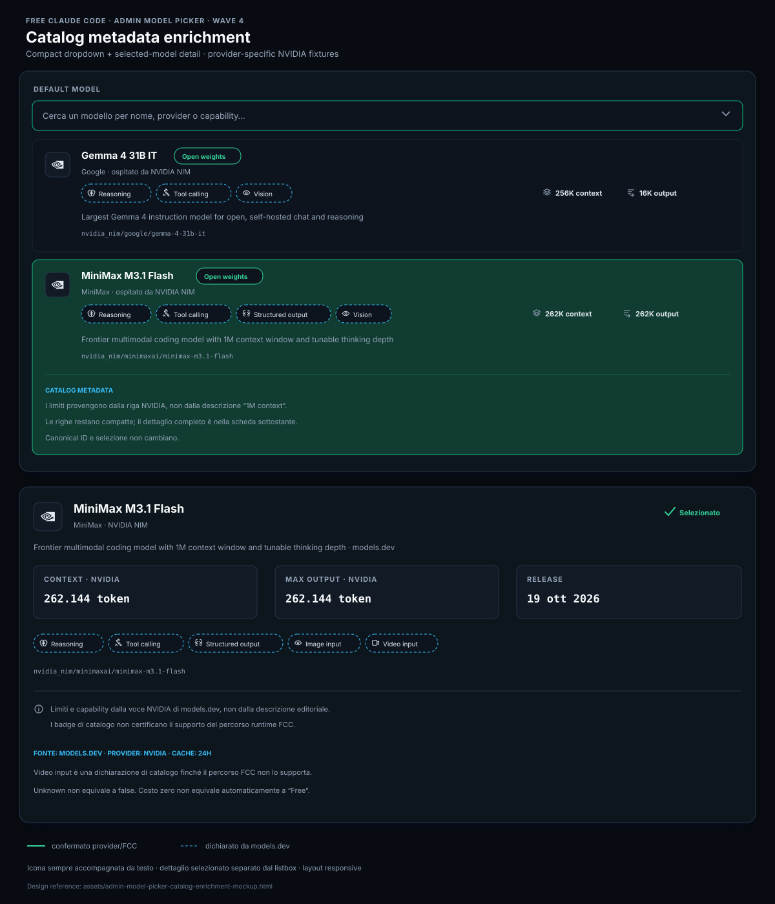

# Implementation Plan: Admin Model Picker Enrichment

Status: implemented for Waves 0–5, including the approved Wave 4 catalog expansion
Input: [`admin-model-picker-enrichment-analysis.md`](admin-model-picker-enrichment-analysis.md)
Audience: Admin UI, API, model metadata, configuration, and test maintainers

This plan turns the Admin model-picker analysis into ordered, reviewable steps. Each step is
one pull request. Steps within a wave are sequential when they share a contract; otherwise
the dependency table identifies the allowed order. The initial release scope and the subsequently
approved catalog expansion are implemented; pricing and a separate model browser remain excluded.

> **UX refinement — 2026-11-22.** Provider names and logos in Model Config reuse the Admin
> Providers catalog and packaged assets exactly. Capability and limit facts use static SVG icons.
> The canonical reference is not shown in visible model information; it remains the routing value
> in state, data attributes, and Apply payloads.

The target behavior separates two values for every known model:

```text
display value:   MiniMax-M3.1-Flash
canonical value: nvidia_nim/minimaxai/minimax-m3.1-flash
```

The canonical value is the ModelGlot `provider_model_ref` used by configuration and routing. It is
not the models.dev `canonical_model_id` field. The display value is presentation only.

> **Implementation update — 2026-11-19.** Model Routing now qualifies known-model display labels
> as `Title (Provider)` whenever more than one provider has `status: "configured"`. The rule
> applies to Default Model, the other route selectors, and both new and existing Fallback Models
> editors, so identical titles from different providers remain distinguishable in the input and in
> the option list. With zero or one configured provider, the display label remains `Title`.
> Provider qualification is presentation only: canonical values, fallback serialization, API-key
> association, and Apply payloads are unchanged. Browser coverage verifies both the multi-provider
> and single-provider cases.
>
> **Wave 4 implementation update — 2026-11-20.** The decision gate was approved by the explicit
> implementation request. Cache schema v2 retains bounded provider-scoped models.dev capabilities,
> modalities, limits, lifecycle, open-weights, canonical lab identity, and freshness while reading
> legacy title caches unchanged. The Admin response adds `model_details[].catalog` without
> backfilling provider/ModelGlot fields. Validated SVG provider/lab logos refresh only in the background
> and are served same-origin with restrictive CSP; missing or invalid assets fall back to initials.
> Compact options and the selected detail card distinguish solid runtime facts from dashed Catalog
> declarations in text as well as styling. Pricing remains excluded.

---

## 0. Ground Rules

These apply to every step in this plan.

1. **One finding focus per pull request.** Each step below proposes one pull request. Do not
   combine independent metadata, value-state, visual, and documentation findings into one
   large change.
2. **Pull request title prefixes are mandatory** for changes touching `assets/`, `scripts/`,
   `src/`, `pyproject.toml`, or `uv.lock`: exactly one of `patch: `, `minor: `, or `major: `
   followed by a description (`CONTRIBUTING.md:15`). The additive Admin behavior in this plan
   uses `minor: `.
3. **Tests accompany behavior.** Every behavioral step includes focused tests and edge cases.
   Updating existing assertions is not a substitute for coverage of the new contract.
4. **Documentation ships with code.** README and project-document updates belong in the same
   pull request as the behavior they describe. The analysis and this plan may land as an
   owner-approved documentation pull request; otherwise bundle them with step S1.1
   (`CONTRIBUTING.md:7`).
5. **Canonical identity is invariant.** No step may persist a display title, alter a provider
   model reference, change routing candidates or fallback order, or translate a title back to
   an identifier by string matching.
6. **Unknown remains unknown.** `null`, absent metadata, and unsupported values must not become
   `false`, zero, a default capability, or an authoritative badge.
7. **No fallback capabilities.** Never use `context_window_for_client()` or its default
   `200000` result to populate Admin model details. The API consumes raw catalog/provider
   facts instead.
8. **Authority controls badges.** Provider identity may use the ModelGlot provider catalog. Runtime
   capabilities and numeric limits require provider-confirmed or explicitly curated ModelGlot facts.
   models.dev text may be shown as attributed editorial description; its limits, capabilities,
   modalities, cost, and dates do not become authoritative badges by default.
9. **Compatibility is additive.** `models`, `model_labels`, and `failed_providers` retain their
   current meaning and shape. New data is exposed through `model_details`.
10. **Custom values remain supported.** Manual provider/model references, unknown models,
    optional `None`, locked fields, fallback rows, and provider refreshes must continue to work.
11. **No suppression shortcuts or version edits.** Follow the existing typing, import-boundary,
    feature-manifest, CI/local-parity, and release rules in `CONTRIBUTING.md`.
12. **Preserve unrelated work.** Implementation must not overwrite pre-existing changes in
    `e2e/test_admin_assets.py`, `src/modelglot/api/admin_static/index.html`,
    `tests/api/test_admin.py`, or any other concurrently edited file. Rebase and merge
    surgically when a planned file is already dirty.

Effort estimates are rough developer-days for a contributor already familiar with the codebase.

---

## Wave 0 — Baseline and Contract Protection

### S0.1 — Record the current routing and picker behavior

**Goal.** Establish a reproducible baseline so later steps can prove that presentation changes
do not alter saved model references or routing.

**Changes.** No production change. Record in the pull request description or a test fixture:

- the `GET /admin/api/models` response from the verified local configuration;
- `MODEL = nvidia_nim/minimaxai/minimax-m3.1-flash`;
- `model_labels["nvidia_nim/minimaxai/minimax-m3.1-flash"] = "MiniMax-M3.1-Flash"`;
- the selected input value, dropdown option text, and Apply payload before enrichment;
- behavior for a manually entered custom model, an optional model set to `None`, a fallback
  row, and a locked/process-owned field;
- the current keyboard sequence: open, ArrowDown/ArrowUp, Home/End, Enter, Escape, and Tab;
- the existing models.dev description, structured limits, capabilities, modalities, cost, and
  release date as research evidence, not as approved UI facts.

**Tests.** Run the focused existing suites without changing their assertions:

```powershell
uv run pytest tests/api/test_admin.py -q
uv run pytest e2e/test_admin_models.py e2e/test_admin_providers.py -q
```

**Acceptance.**

- The baseline distinguishes visible input text from the canonical Apply payload.
- The existing `models` and `model_labels` payload is recorded byte-for-byte for the fixture.
- The MiniMax fixture records provider facts as unknown and does not record the fallback 200K
  context as a provider limit.

**Documentation.** Link the baseline from the analysis Evidence Index when the first code step
lands.

**Dependencies.** None; this step precedes every behavioral step.

**Rollback.** Documentation/test-fixture removal only; no runtime rollback is required.

**Effort.** 0.5 day.

---

## Wave 1 — Model Details and API Contract

### S1.1 — Preserve model descriptions without changing title resolution

**Finding.** The reduced models.dev cache already stores name and description, but the title
resolver consumes only the name. The existing `CatalogModel.description` is provider
attribution, so it cannot simply be repurposed as a model-purpose description.

**Goal.** Make the cached model description available to the application inventory while
keeping title resolution, provider attribution, public model IDs, and existing client
projections unchanged.

**Changes.**

- `src/modelglot/application/model_titles.py` — add a small, pure metadata resolver or
  lookup helper that can return both cached values. Keep `resolve_model_title()` behavior and
  its public result unchanged. Do not perform I/O or fetch models.dev from this layer.
- `src/modelglot/application/model_catalog.py` — add explicit presentation fields such
  as `model_description` and `model_description_source` to `CatalogModel`; keep the existing
  `description` provider-attribution field unchanged for current consumers.
- `src/modelglot/application/model_catalog.py` — derive provider label separately from
  model-purpose description. Custom providers use their configured display name as the provider
  label and do not invent a model description.
- `src/modelglot/providers/model_catalog_source.py` — no cache-schema change is needed
  for the initial release because the reduced cache already retains `name` and `description`.
  Add or adjust tests only if the current read/write compatibility behavior is not already
  covered.
- `src/modelglot/config/model_title_overrides.py` — do not add MiniMax-specific context
  claims. A curated description may be added only when its wording and provenance are reviewed.

**Tests.**

- `tests/application/test_model_titles.py`:
  - title-only legacy cache entries still resolve exactly as before;
  - a cached `(name, description)` pair returns the same title and exposes the description;
  - missing, blank, or malformed descriptions become absent, never fabricated;
  - curated title precedence remains unchanged.
- `tests/application/test_model_catalog.py`:
  - model-purpose description and provider attribution remain distinct;
  - the MiniMax/NVIDIA NIM fixture exposes `MiniMax-M3.1-Flash`, `NVIDIA NIM`, and the cached
    description without changing `provider_model_ref` or `wire_slug`;
  - an absent cache leaves title fallback and provider attribution unchanged.
- `tests/providers/test_model_catalog_source.py`:
  - cache read/write preserves both name and description;
  - older title-only cache entries remain readable.

**Acceptance.**

- `resolve_model_title()` produces the same result for every baseline fixture.
- The description `1M context` can be carried as catalog text with models.dev provenance, but
  it is not parsed into a numeric context limit.
- Existing Claude/Desktop/API descriptions remain unchanged.

**Documentation.** State the distinction between provider attribution and model-purpose
description in the relevant model-catalog documentation. Bundle this plan and its analysis if
they have not already landed.

**Dependencies.** S0.1.

**Rollback.** Revert the additive application fields and resolver helper. The existing cache
format remains valid, so no cache deletion or migration is necessary.

**PR title.** `minor: Preserve model descriptions in the application catalog`

**Effort.** 1 day.

---

### S1.2 — Add `model_details` to the Admin model API

**Finding.** `/admin/api/models` exposes only canonical IDs and titles; the picker cannot render
provider, description, or capability details without inventing client-side metadata.

**Goal.** Add a typed, additive details projection keyed by the canonical provider/model
reference.

**Changes.**

- `src/modelglot/api/admin_routes.py` — extend `_model_options()` with a `model_details`
  map for both `GET /admin/api/models` and `POST /admin/api/models/refresh`.
- Use the application inventory as the only source. Do not add provider calls or models.dev
  requests to either endpoint.
- Emit the following fields for each known model:

| Field | Meaning |
| --- | --- |
| `display_name` | Same resolved title as `model_labels` |
| `provider_id` | ModelGlot provider identifier |
| `provider_label` | Human-readable provider badge text |
| `description` | Optional model-purpose text |
| `description_source` | Optional provenance such as `models.dev` |
| `supports_reasoning` | Provider-confirmed boolean or `null` |
| `input_modalities` | Provider-confirmed modelglot-supported modalities or `null` |
| `context_window_tokens` | Raw provider-confirmed limit or `null` |
| `max_output_tokens` | Raw provider-confirmed limit or `null` |

- Keep `models`, `model_labels`, and `failed_providers` unchanged.
- Omit unsupported modalities rather than passing through models.dev audio/video/PDF claims.
- Do not expose price, release date, tools, structured output, or models.dev limits in the
  initial authoritative badge contract. They remain candidates for the gated Wave 4.

**Tests.**

- `tests/api/test_admin.py`:
  - the existing `models` and `model_labels` values remain exactly equal to the S0.1 baseline;
  - `model_details` has the same canonical keys as `model_labels`;
  - the MiniMax fixture returns `MiniMax-M3.1-Flash`, provider `nvidia_nim`/`NVIDIA NIM`, the
    attributed description, and `null` provider capabilities/limits;
  - a provider-backed fixture with known reasoning, image input, context, and output returns
    those facts;
  - unknown booleans remain `null`, not `false`;
  - absent context does not become `200000`;
  - refresh returns the same additive shape and preserves partial-failure behavior;
  - no provider/network refresh is triggered by reading the endpoint.

**Acceptance.**

- The example response in analysis §6 is reproducible from a fixture.
- The endpoint remains a read of cached/application state.
- The new payload contains enough information for title, provider badge, description, canonical
  reference, and authoritative badges without client-side lookups.

**Documentation.** Document `model_details` and unknown-value semantics next to the Admin API
contract, without presenting it as a public non-loopback API.

**Dependencies.** S1.1.

**Rollback.** Remove `model_details` from the response. Existing consumers of `models` and
`model_labels` require no migration.

**PR title.** `minor: Add structured model details to the Admin model API`

**Effort.** 1 day.

---

## Wave 2 — Canonical and Display Value Separation

### S2.1 — Give the combobox an explicit canonical-value channel

**Finding.** `ModelGlotModelCombobox.select()` writes the canonical reference into `input.value`, and
`readFieldValue` reads that value directly. Replacing it with a title without another identity
channel would persist the title and break routing.

**Goal.** Display a resolved title while keeping the canonical provider/model reference as the
only value used for dirty-state comparison, fallback membership, and persistence.

**Changes.**

- `src/modelglot/api/admin_static/model_combobox.js`:
  - store canonical identity in component state and `input.dataset.canonicalValue`;
  - expose one canonical-value accessor for Admin consumers;
  - on known-model selection, set canonical state to `optionEl.dataset.value` and visible input
    text to `displayValue(canonicalValue)`;
  - on initial hydration, map a configured canonical value to its title when a label exists;
  - on genuine user typing, clear the known-selection mapping so the typed text is treated as a
    custom canonical value;
  - use canonical identity, not visible text, to find the selected option;
  - keep `optionEl.dataset.value` canonical and preserve keyboard/active-descendant behavior;
  - search across canonical reference, title, provider label, and description without changing
    the stored value.
- `src/modelglot/api/admin_static/admin.js`:
  - make `readFieldValue()` use the canonical accessor for model fields;
  - keep optional `None` mapped to `null` before persistence;
  - preserve `input.dataset.original` as the canonical baseline;
  - update `ModelListEditor` add/edit/provider/API-key logic to read canonical values through the
    same accessor rather than `combobox.input.value`;
  - qualify known-model display labels as `Title (Provider)` when more than one configured
    provider exists, resolving the provider display name from the canonical provider prefix; do
    not alter `model_labels` or append provider text to canonical/custom values;
  - ensure model refreshes update labels/details without overwriting a custom edit in progress.
- Do not infer a canonical value by looking up a title. Duplicate titles and unknown custom
  values must remain safe.

**State rules.**

| Interaction | Visible value | Canonical value |
| --- | --- | --- |
| Initial known model | Resolved title, with `(Provider)` when multiple providers are configured | Original provider/model reference |
| Select known option | Resolved title, with `(Provider)` when multiple providers are configured | Selected option's `data-value` |
| Type custom model | Typed text | Same typed text |
| Edit a known title | Edited text | Edited text, treated as custom |
| Optional `None` | `None` | `null` at Admin serialization |
| Unknown metadata | Canonical reference | Same canonical reference |

**Tests.**

- `tests/api/test_admin.py` static contract coverage:
  - canonical state and display text have separate code paths;
  - no persistence path reads a display label as the model ID;
  - fallback editor uses the canonical accessor;
  - no title-to-canonical reverse lookup is introduced.
- `e2e/test_admin_models.py`:
  - selecting `MiniMax-M3.1-Flash` displays that title and sends
    `nvidia_nim/minimaxai/minimax-m3.1-flash` in Apply;
  - selecting then reopening without edits produces `No changes` and no Apply payload field;
  - typing a custom reference marks the field dirty and saves the custom reference;
  - clearing/replacing a known title does not resurrect the previous canonical selection;
  - duplicate display titles select their own distinct canonical references;
  - with multiple configured providers, Default Model and Fallback Models display
    `Shared Model (OpenRouter)` and `Shared Model (Groq)` while preserving their distinct canonical
    references in fallback state and Apply;
  - with one configured provider, the same titles remain unqualified as `Shared Model`;
  - `None`, fallback add/edit, provider-specific API-key selection, and reload round trips remain
    correct;
  - Arrow/Escape/Enter/Tab behavior and focus restoration remain correct.
- `e2e/test_admin_providers.py`:
  - replace the raw-input-only assumption with assertions for both visible title and canonical
    serialization; retain a regression assertion that the provider/model reference is unchanged.

**Acceptance.**

- The displayed MiniMax title and persisted canonical value are simultaneously observable and
  different.
- Dirty state is based only on canonical values.
- Equal model titles are visibly provider-qualified whenever multiple providers are configured.
- Every existing model and fallback workflow from the baseline passes.

**Documentation.** Add a short maintainer note explaining the canonical/display invariant and
warning future consumers not to read model identity from visible input text.

**Dependencies.** S1.2 so initial and refreshed display data use the same contract. The
canonical/display mechanics may be prototyped earlier, but must not merge against an undefined
metadata contract.

**Rollback.** Revert the combobox and Admin reader changes together. Rolling back only one side
is unsafe because it can expose or persist a title as a model ID.

**PR title.** `minor: Separate display and canonical values in the Admin model picker`

**Effort.** 2 days.

---

## Wave 3 — Enriched Graphical Presentation

### S3.1 — Render title-first options and a selected-model summary

**Finding.** The current option is one monospace text node and the selected field has no place
for provider, description, canonical reference, or badges.

**Goal.** Present useful model details while keeping the canonical reference secondary and the
control editable.

**Changes.**

- Add a focused presentation helper, preferably
  `src/modelglot/api/admin_static/model_picker_details.js`, loaded before
  `model_combobox.js`/`admin.js` from `src/modelglot/api/admin_static/index.html`.
  Register the new filename in `_ADMIN_ASSET_FILENAMES` in
  `src/modelglot/api/admin_routes.py`; otherwise the versioned asset route will not serve
  it. Integrate with any pre-existing index changes rather than replacing the file.
- The helper converts `model_details` into a safe view model:
  - prominent title;
  - provider badge;
  - optional attributed description;
  - canonical reference as secondary monospace text;
  - capability/limit badges only for authoritative, known facts.
- `src/modelglot/api/admin_static/model_combobox.js` renders structured option rows using
  DOM nodes and `textContent`; never inject catalog text with `innerHTML`.
- `src/modelglot/api/admin_static/admin.js` renders the selected-model summary adjacent
  to the combobox and refreshes it on selection, custom input, hydration, and model refresh.
- For the MiniMax fixture:
  - show `MiniMax-M3.1-Flash` prominently;
  - show an `NVIDIA NIM` provider badge;
  - show `1M context` only as the models.dev description, never as a structured `1M` badge;
  - show the canonical reference as secondary detail;
  - show no reasoning, tools, structured-output, context, output, cost, release, or video badge
    when the only evidence is the current models.dev entry.
- Unknown/custom models fall back to title-equals-canonical presentation without empty badges or
  placeholder descriptions.

**Tests.**

- `e2e/test_admin_assets.py` and the API static-asset tests:
  - `model_picker_details.js` is served through the versioned asset route before the dependent
    scripts execute;
  - no browser page error reports a missing helper or asset.
- Helper tests through the existing browser/E2E harness:
  - authoritative known values produce the expected badges;
  - `null`, `false`, absent, and fallback values produce no positive capability badge;
  - catalog description never becomes a numeric limit badge;
  - video and other modelglot-unsupported modalities are omitted;
  - long and HTML-like descriptions are rendered as text, not markup;
  - custom/unknown values produce a minimal valid summary.

**Acceptance.**

- The MiniMax selected state visibly contains title, provider, description, and canonical
  reference with the prescribed hierarchy.
- No prohibited badge appears for the MiniMax fixture.
- The helper has no routing or persistence responsibilities.

**Documentation.** Include a small UI contract/example in the Admin documentation and record
that models.dev description is editorial text rather than a confirmed runtime limit.

**Dependencies.** S2.1; rendering must not introduce another value-state implementation.

**Rollback.** Remove the helper and structured rendering while retaining S2.1's canonical/display
separation. The picker returns to title-only options without changing saved configuration.

**PR title.** `minor: Add title-first model details to the Admin picker`

**Effort.** 1.5 days.

---

### S3.2 — Style, responsive behavior, and accessibility hardening

**Finding.** Rich option content can overflow the two-column Model Routing layout and can make
the active option or accessible name ambiguous.

**Goal.** Deliver a legible, keyboard- and screen-reader-compatible picker at desktop and narrow
widths.

**Changes.**

- `src/modelglot/api/admin_static/admin.css`:
  - separate title, provider badge, description, canonical reference, and capability-badge
    typography;
  - replace the current all-monospace option treatment with monospace only for the canonical
    reference;
  - allow wrapping without clipping and preserve the dropdown's scroll constraints;
  - stack secondary content at narrow widths;
  - retain visible hover, active, focus, disabled, and locked states;
  - keep provider badges visually distinct from capability badges and never rely on color alone.
- `src/modelglot/api/admin_static/model_combobox.js` and `admin.js`:
  - preserve a concise accessible name for the input;
  - associate canonical/description text with `aria-describedby` where useful;
  - give each option an unambiguous accessible name containing its title and canonical identity;
  - mark decorative badge separators/icons hidden from assistive technology;
  - keep one active descendant and correct `aria-selected` state after filtering.

**Tests.**

- `e2e/test_admin_models.py` and `e2e/test_admin_assets.py`:
  - 1280px, 900px, and 390px layouts have no horizontal document overflow;
  - long titles, canonical references, descriptions, and badges wrap without hiding the toggle;
  - option activation and input focus remain visible;
  - accessible option names distinguish duplicate titles;
  - keyboard navigation still scrolls the active option into view;
  - reduced-motion behavior remains unchanged.
- Merge carefully with any existing asset/layout tests rather than weakening their assertions.

**Acceptance.**

- Model Routing and fallback rows remain usable at all baseline viewport sizes.
- Screen-reader output identifies both the selected model and its canonical reference without
  reading decorative badge punctuation as essential content.

**Documentation.** Record the supported responsive and keyboard behavior in the same pull
request.

**Dependencies.** S3.1.

**Rollback.** Revert the CSS/accessibility refinement only if the underlying semantic DOM remains
compatible; otherwise roll back with S3.1. Do not roll back S2.1 as part of a visual-only issue.

**PR title.** `minor: Make enriched Admin model options responsive and accessible`

**Effort.** 1 day.

---

## Wave 4 — Catalog Metadata Expansion (Approved and Implemented)

> **Research and design update — 2026-11-19.** The current Admin screenshot is the expected
> Waves 0–3 result, not a failed models.dev lookup. The reduced cache retains only name and
> description, and the picker renders only provider-confirmed reasoning, image input, context,
> and output. The research below turns the deferred catalog idea into an implementable design;
> it does not approve or ship that design.

### 4.1 Verified implementation gap

The following current behavior is the baseline for Wave 4:

- `src/modelglot/providers/model_catalog_source.py:125-155` reduces every models.dev
  entry to `(name, description)` and discards all structured fields;
- `src/modelglot/api/admin_routes.py:629-654` exposes provider attribution, editorial
  description, reasoning, ModelGlot input modalities, context, and output through `model_details`;
- `src/modelglot/api/admin_static/model_picker_details.js:22-43` creates badges only for
  provider-confirmed reasoning, image input, context, and output;
- tool calling, structured output, audio, video, PDF, lifecycle, open weights, logos, and
  catalog freshness have no current cache/Admin presentation contract;
- `src/modelglot/api/admin_static/admin.css:672-686` constrains the dropdown to `280px`,
  so placing every possible detail in every option would make scanning and keyboard navigation
  worse rather than better.

Wave 4 must extend the existing background-refresh/cache path. It must not add models.dev or
provider I/O to model selection or to `GET /admin/api/models`.

### 4.2 External research and provider-specific evidence

Research was checked against the live models.dev v1 API/schema and model pages on 2026-11-19.
The stable v1 `https://models.dev/api.json` payload is sufficient for the first catalog wave;
the experimental v2 API is not a dependency.

Relevant provider-entry fields are:

| Field group | models.dev v1 fields | Initial Admin use |
| --- | --- | --- |
| Editorial identity | `name`, `description`, `canonical_model_id` | Existing title/description plus lab attribution |
| Capabilities | `reasoning`, `tool_call`, `structured_output` | Catalog-only icon-and-text badges |
| Modalities | `modalities.input`, `modalities.output` | Text/image/audio/video/PDF badges with catalog provenance |
| Limits | `limit.context`, `limit.input`, `limit.output` | Provider-specific catalog facts, never description-derived |
| Lifecycle | `status`, `release_date`, `last_updated`, `knowledge` | Selected-model detail panel |
| Distribution | `open_weights` | Neutral informational badge |
| Reasoning controls | `reasoning_options`, when present | Optional detail only after schema validation |
| Pricing | `cost.input`, `cost.output`, cache/audio variants | Retain only if needed; omit from the initial UI |
| Logo assets | `/logos/{provider}.svg`, `/logos/labs/{lab}.svg` | Same-origin, validated/cached presentation assets |

The same model has different limits and sometimes different capabilities across hosts. These
two live records are mandatory design fixtures:

| Model | Provider-agnostic model page | NVIDIA provider row | Required interpretation |
| --- | --- | --- | --- |
| Gemma 4 31B IT | `262144` context, `32768` output | `256000` context, `16384` output | Use the NVIDIA row for `nvidia_nim/google/gemma-4-31b-it` |
| MiniMax M3.1 Flash | `1000000` context, `512000` output | `262144` context, `262144` output | Never turn the editorial `1M context` sentence into an NVIDIA limit |

Both NVIDIA rows report reasoning and tool calling; the MiniMax NVIDIA row also reports
structured output. MiniMax's editorial description still says `1M context`, proving that
editorial text and structured provider limits must remain separate.

Sources:

- [models.dev README, v1 API, schema, and logos](https://github.com/anomalyco/models.dev/blob/dev/README.md);
- [MiniMax M3.1 Flash model and provider rows](https://models.dev/models/minimax/MiniMax-M3.1-Flash);
- [Gemma 4 31B IT model and provider rows](https://models.dev/models/google/gemma-4-31b-it);
- [Vercel AI Gateway model catalog](https://vercel.com/ai-gateway/models) and
  [OpenRouter model catalog](https://openrouter.ai/models) for the compact-list/detail-page UI
  pattern;
- [WAI-ARIA tooltip pattern](https://www.w3.org/WAI/ARIA/apg/patterns/tooltip) for keyboard and
  Escape behavior when supplementary tooltips are used.

The key source rule is: **use the provider-scoped `api.json` entry for host-specific facts, not
the provider-agnostic `models.json` record and never parsed description text.**

### 4.3 Approved-for-design UX direction and reusable mockups

The recommended target is a **hybrid compact dropdown plus selected-model detail card**.
Alternatives remain recorded so implementation does not accidentally drift into an oversized
listbox:

| Alternative | Assessment |
| --- | --- |
| Full details in every option | Rejected: excessive height, repetition, poor keyboard scanning |
| Compact rows plus selected-model detail card | **Recommended Wave 4 target** |
| Separate searchable/filterable catalog table | Useful later, but out of scope for this wave |

Design artifacts:

- [Self-contained HTML design prototype](../assets/admin-model-picker-catalog-enrichment-mockup.html)
  preserves the editable visual reference, inline icons, responsive rules, and provenance legend;
- [SVG overview](../assets/admin-model-picker-catalog-enrichment-mockup.svg) is the repository
  documentation preview. Both are design assets only and are not production Admin assets.



The implementation must reproduce the mockup's information hierarchy, not necessarily its exact
pixels, fonts, or temporary hard-coded values:

1. **Compact option row**
   - 32px hosting-provider logo with initials fallback;
   - readable model title and optional neutral `Open weights`/lifecycle marker;
   - separate `Lab · ospitato da Provider` attribution;
   - icon-and-text badges for the highest-value positive capabilities;
   - compact context/output facts aligned on the trailing side when space permits;
   - attributed description clamped to two lines and canonical reference kept secondary.
2. **Selected-model detail card**
   - larger provider identity, title, lab, selection state, description, and canonical reference;
   - exact context/output values and release date;
   - complete approved capability set, including audio/video/PDF only with catalog semantics;
   - visible source, provider-specific scope, freshness, and runtime-vs-catalog explanation.
3. **Responsive/accessibility behavior**
   - badges always include visible text; icons are decorative and `aria-hidden`;
   - no interactive button is nested inside a `role="option"` row;
   - supplementary tooltips work on hover and keyboard focus and dismiss with Escape;
   - compact facts wrap below badges at narrow widths and detail stats become one column;
   - existing combobox focus, active descendant, selection, canonical-value, and custom-edit
     behavior remains unchanged.

### 4.4 Data authority and visual provenance contract

Wave 4 distinguishes three facts that must never be conflated:

| Layer | Question answered | Examples |
| --- | --- | --- |
| Model/lab metadata | What is the underlying model generally declared to do? | MiniMax authorship, editorial purpose, open weights |
| Hosting-provider catalog metadata | What does models.dev declare for this exact hosted model? | NVIDIA MiniMax `262144` context and tool calling |
| ModelGlot/provider runtime metadata | What is confirmed for the actual ModelGlot request/translation path? | Provider-confirmed reasoning and modelglot-supported text/image input |

Visual and precedence rules:

- solid/success badges mean provider/modelglot-confirmed runtime support;
- dashed/info badges mean models.dev catalog declarations and always have an accessible source
  explanation;
- neutral lifecycle/open-weights badges are not runtime capability assertions;
- unknown and absent remain unknown: no grey “unsupported” badge and no conversion to `false`;
- an explicit provider runtime fact wins over a conflicting catalog fact;
- a missing provider fact may produce a **catalog-only** badge, never a provider-confirmed one;
- conflicting catalog values are not shown as a second contradictory runtime value;
- audio/video/PDF may be displayed only as catalog declarations until the exact ModelGlot route
  supports them; they must not be presented as ModelGlot runtime support;
- missing cost is unknown and explicit `cost: 0` is not translated to “Free”; pricing is omitted
  from the initial Wave 4 UI;
- compact token units use one documented convention, while the detail card shows the exact raw
  integer and unit;
- source and `fetched_at`/staleness are available in the detail view; stale data does not block
  selection or routing.

### S4.1 — Retain provider-scoped models.dev facts and source metadata

**Goal.** Extend the reduced cache with a small, validated, provider-specific presentation
contract without changing routing or provider runtime facts.

**Decision gate — approved 2026-11-20.** The explicit implementation request approves the hybrid UX,
provider-scoped catalog badges, dashed provenance treatment, description-conflict handling, and
catalog-only treatment of modalities not supported by ModelGlot. Pricing remains excluded unless a
separate decision approves it.

**Changes.**

- `src/modelglot/providers/model_catalog_source.py`:
  - continue consuming the configured v1 `api.json` endpoint through the existing background
    refresh;
  - replace the `(name, description)`-only reduction with a versioned metadata record while
    preserving legacy title-only and name/description cache reads;
  - retain only allowlisted scalar/array fields for editorial identity, capabilities,
    modalities, limits, lifecycle, open weights, canonical ID, and optional reasoning options;
  - retain `fetched_at` and the entry's `last_updated`; bound string/array sizes and reject
    malformed field types without accepting partial coercions;
  - preserve atomic writes, stale-on-error behavior, and the existing 24-hour refresh policy;
  - do not retain benchmarks, arbitrary metadata, links, weights payloads, or pricing in this
    step.
- `src/modelglot/application/model_catalog.py`:
  - add a separate catalog-metadata value object/field on `CatalogModel`;
  - keep all existing provider-owned fields unchanged;
  - use the existing modelglot-to-models.dev provider mapping, including `nvidia_nim -> nvidia`;
  - resolve the lab from the validated `canonical_model_id` rather than guessing from titles.
- `tests/providers/test_model_catalog_source.py` and
  `tests/application/test_model_catalog.py`: add legacy, malformed, partial, stale, conflict,
  MiniMax, and Gemma fixtures.

**Tests and acceptance.**

- Legacy caches round-trip without migration or loss of titles/descriptions.
- MiniMax resolves NVIDIA `262144/262144`, not generic `1000000/512000` and not fallback `200000`.
- Gemma resolves NVIDIA `256000/16384`, not generic `262144/32768`.
- `1M context` remains editorial text and never populates a numeric field.
- Missing/`null` capability values remain unknown; explicit booleans are not string-coerced.
- Unsupported/extra upstream fields are ignored and cannot change canonical ModelGlot model IDs.
- No endpoint or selection interaction performs external I/O.

**Documentation.** Update the cache-schema note and record the approved source-precedence table
from §4.4.

**Dependencies.** S3.2 plus explicit product/maintainer approval.

**Rollback.** Ignore the additive metadata and continue reading the legacy cache fields. Do not
delete or destructively migrate the cache.

**PR title.** `minor: Retain provider-scoped models.dev metadata for the Admin picker`

**Effort.** 1.5 days after the decision gate.

---

### S4.2 — Expose additive catalog details and safe same-origin logos

**Goal.** Give the Admin frontend enough structured data to render provenance-aware details
without client-side lookups or changes to existing provider-fact fields.

**Changes.**

- `src/modelglot/api/admin_routes.py`:
  - retain every S1.2 field and its meaning;
  - add a nested `catalog` object to each eligible `model_details` entry;
  - include `source`, `source_provider_id`, `canonical_model_id`, `fetched_at`, `last_updated`,
    lab identity, approved capabilities/modalities/limits, release/status, and open weights;
  - expose logo URLs only as same-origin, validated asset references with explicit fallback
    behavior;
  - keep cost out of the response until separately approved.
- Logo handling:
  - map the hosting provider through the existing provider mapping and the lab through the
    validated canonical ID;
  - fetch/cache provider and lab SVGs outside the Admin read path, with timeout, size/content
    validation, and initials fallback;
  - serve validated assets same-origin with an SVG-safe content type and restrictive CSP; never
    inject fetched SVG markup with `innerHTML` or execute external scripts;
  - missing logos and offline refreshes must not hide model metadata or block the picker.
- `tests/api/test_admin.py` and focused cache/logo tests:
  - verify the additive response, same keys as `model_labels`, refresh parity, no request-path
    I/O, safe URLs, fallback logos, and legacy-cache behavior.

**Illustrative additive shape.** Existing provider fields remain siblings; this example shows
only the new namespace:

```json
{
  "catalog": {
    "source": "models.dev",
    "source_provider_id": "nvidia",
    "canonical_model_id": "minimax/MiniMax-M3.1-Flash",
    "lab": { "id": "minimax", "label": "MiniMax", "logo_url": "/admin/..." },
    "provider_logo_url": "/admin/...",
    "fetched_at": 1795046400,
    "last_updated": "2026-10-19",
    "reasoning": true,
    "tool_call": true,
    "structured_output": true,
    "modalities": { "input": ["text", "image", "video"], "output": ["text"] },
    "limit": { "context": 262144, "output": 262144 },
    "release_date": "2026-10-19",
    "status": null,
    "open_weights": true
  }
}
```

**Acceptance.**

- A reviewer can determine source, host scope, freshness, lab, and authority from the payload.
- Existing provider reasoning/modalities/context/output fields are neither overwritten nor
  backfilled from `catalog`.
- MiniMax and Gemma API fixtures expose the exact NVIDIA values from §4.2.
- Unknown/custom models retain their minimal response and presentation.

**Documentation.** Document the nested contract as loopback-Admin-only and additive, including
unknown semantics and logo fallback behavior.

**Dependencies.** S4.1.

**Rollback.** Remove `catalog` and logo URLs from the response. Existing S1.2 consumers require
no migration; cached catalog data may remain unused.

**PR title.** `minor: Expose provenance-aware model catalog details in the Admin API`

**Effort.** 1 day.

---

### S4.3 — Implement the compact dropdown and selected-model detail card

**Goal.** Match the approved mockup hierarchy while preserving the current combobox identity,
keyboard, refresh, and custom-model contracts.

**Changes.**

- `src/modelglot/api/admin_static/model_picker_details.js`:
  - build separate compact-option and selected-detail view models;
  - render provider/lab identity, logos with fallback, icon-and-text capability badges,
    context/output, editorial description, canonical reference, lifecycle, and source metadata;
  - render provider/ModelGlot facts as solid badges and catalog declarations as dashed badges;
  - never infer capabilities from titles/descriptions and never turn unknown into false;
  - use DOM nodes and `textContent`; external/catalog strings remain bounded plain text.
- `src/modelglot/api/admin_static/model_combobox.js` and `admin.js`:
  - retain one canonical-value implementation and existing option `data-value` behavior;
  - keep option DOM non-interactive apart from selection; place any copy/detail controls outside
    the listbox;
  - refresh the selected detail card on hydration, selection, custom edit, and model refresh;
  - preserve search and optionally extend it to provider, lab, and explicit capability labels
    without changing filtering identity.
- `src/modelglot/api/admin_static/admin.css`:
  - implement the mockup's 32px logo, compact rows, badge wrapping, two-line description,
    trailing token facts, selected-detail stats, and narrow-width stacking;
  - do not rely on color alone: dashed versus solid borders and visible provenance text are
    required;
  - keep decorative icons hidden from assistive technology and badge text readable at 200% zoom.
- Keep benchmarks, pricing, full catalog filters, and a separate model browser out of this step.

**Tests.**

- Browser/helper coverage for solid provider badges, dashed catalog badges, unknown/false/null,
  exact/compact token formatting, logo fallback, HTML-like strings, source freshness, and stale
  cache;
- MiniMax shows NVIDIA `262144/262144`, reasoning/tools/structured output, and catalog-only
  video; its description may still contain attributed `1M context` without producing a `1M`
  badge;
- Gemma shows NVIDIA `256000/16384` and no fabricated structured-output/audio capability;
- 1280px, 900px, and 390px layouts have no horizontal document overflow;
- keyboard navigation, focus, active descendant, Enter/Escape/Tab, custom references, `None`,
  fallbacks, Apply payloads, and no-change behavior remain correct;
- any supplementary tooltip is focusable through its trigger, hover/focus persistent, and
  Escape-dismissable without moving focus.

**Acceptance.**

- The rendered structure visibly matches the linked mockup: compact options and a complete
  selected-model card rather than full details in every option.
- Every catalog badge is distinguishable without color alone and has an accessible source
  explanation.
- No audio/video/PDF badge claims ModelGlot runtime support without provider/ModelGlot evidence.
- No canonical ID, routing candidate, fallback order, or Apply payload changes.

**Documentation.** Add a concise Admin UI contract and link the HTML/SVG design references from
the implementation notes.

**Dependencies.** S4.2 and the design artifacts in §4.3.

**Rollback.** Disable S4.3 rendering and retain the S3.x presentation. The additive API/cache
fields may remain unused without affecting persistence.

**PR title.** `minor: Add provenance-aware capabilities and model details to the Admin picker`

**Effort.** 2 days.

---

### S4.4 — Verify catalog conflicts, responsive rendering, and operational fallback

**Goal.** Prove the integrated Wave 4 behavior against the researched fixtures and failure modes
before changing its status to implemented.

**Changes and verification.**

- Add integrated MiniMax and Gemma fixtures to `e2e/test_admin_models.py` and
  `e2e/test_admin_assets.py`; merge surgically with concurrent test changes.
- Exercise legacy cache, missing catalog, stale cache, provider/catalog conflict, malformed
  metadata, missing logos, offline refresh, and partial provider refresh failure.
- Compare the rendered option/detail structure with the SVG/HTML design references at desktop
  and narrow widths; use semantic assertions rather than brittle pixel-perfect screenshots.
- Inspect the actual Apply request and refreshed `model_details` payload manually against a local
  NVIDIA-shaped configuration.
- Run the relevant focused suites and the complete CI sequence from S5.1.

**Acceptance.**

- All S4.1–S4.3 acceptance criteria pass together.
- A stale or absent catalog never removes provider facts, blocks model selection, or changes
  routing.
- The UI never silently promotes catalog data to provider/ModelGlot authority.
- Source links in this plan resolve and the HTML prototype remains self-contained/offline.
- Implementation status and measured test results are recorded here and in the analysis.

**Dependencies.** S4.3.

**Rollback.** Use S4.3, S4.2, and S4.1 rollbacks in that order. Visual rollback alone must not
require cache deletion or canonical-configuration migration.

**PR title.** `minor: Verify provenance-aware Admin model catalog enrichment`

**Effort.** 1 day.

---

## Wave 5 — End-to-End Verification and Documentation

### S5.1 — Complete regression coverage and publish the final contract

**Goal.** Verify the combined feature against the live-shaped MiniMax scenario and leave a
maintainable contract for future Admin changes.

**Changes.**

- `e2e/test_admin_models.py` — add the integrated known-model, custom-model, fallback, refresh,
  persistence, keyboard, and narrow-viewport scenarios not already landed with earlier steps.
- `e2e/test_admin_providers.py` — verify provider setup and Model Routing still retain the same
  canonical provider/model reference after enrichment.
- `tests/api/test_admin.py` — retain focused API/static contracts without relying only on source
  string assertions for behavior already covered in the browser.
- `docs/admin-model-picker-enrichment-analysis.md` — change Status to implemented only when the
  corresponding steps have shipped; record any deferred Wave 4 decisions.
- `docs/admin-model-picker-enrichment-implementation-plan.md` — record shipped step status and
  measured verification results.
- `docs/model-picker-metadata-research.md` — repair or replace the dangling reference to
  `model-picker-metadata-implementation-plan.md` by clearly separating Terminal/Desktop research
  from this Admin-specific plan. Do not silently claim this Admin plan implements that separate
  Terminal/Desktop proposal.
- `docs/model-picker-info-enrichments.md` — cross-link this Admin work and correct its generic
  badge examples where they conflict with the authority rules.
- `CONTRIBUTING.md` — add both new documents under Project Documentation when the feature lands.
- `README.md` — add a concise Admin Model Routing description only if user-facing behavior needs
  operator explanation.

**Tests and final verification.**

```powershell
uv run pytest tests/api/test_admin.py tests/application/test_model_titles.py tests/application/test_model_catalog.py tests/providers/test_model_catalog_source.py -q
uv run pytest e2e/test_admin_models.py e2e/test_admin_providers.py e2e/test_admin_assets.py -q
uv run ruff check
uv run ty check
.\scripts\ci.ps1
```

Run the equivalent `./scripts/ci.sh` on macOS/Linux. Perform one manual verification against the
local Admin server using the MiniMax configuration and inspect both the selected state and the
actual Apply request.

**Acceptance.**

- Visible display value is `MiniMax-M3.1-Flash`.
- Canonical value everywhere in configuration, fallbacks, and Apply payloads is
  `nvidia_nim/minimaxai/minimax-m3.1-flash`.
- `models` and `model_labels` are unchanged from baseline; `model_details` is additive.
- No `1M` structured badge, fallback `200K` capability, “free” label, or ModelGlot runtime video
  promise appears. If Wave 4 ships, video is permitted only as an explicitly catalog-scoped
  declaration under S4.3.
- Keyboard, responsive, custom-model, optional-model, locked-field, refresh, and persistence
  checks pass.
- All relevant documents link to each other and no new dangling local Markdown links remain.

**Dependencies.** S1.1–S3.2 for the initial release; S4.1–S4.4 if the optional catalog wave was
approved and included.

**Rollback.** Use the step-level rollbacks in reverse order. A documentation-only correction does
not require runtime rollback. If persistence correctness is in doubt, disable enriched rendering
and restore the canonical-input UI before release.

**PR title.** Use the prefix required by the files touched; for the combined source/test/docs
verification step, `minor: Verify and document the enriched Admin model picker`.

**Effort.** 1 day.

---

## Dependency and Sequencing Notes

| Step | Depends on | May run independently? |
| --- | --- | --- |
| S0.1 | None | Baseline only |
| S1.1 | S0.1 | No |
| S1.2 | S1.1 | No |
| S2.1 | S1.2 | Prototype only before API merge |
| S3.1 | S2.1 | No |
| S3.2 | S3.1 | No |
| S4.1 | S3.2 + product decision | Optional and separately gated |
| S4.2 | S4.1 | No |
| S4.3 | S4.2 + approved mockup hierarchy | No |
| S4.4 | S4.3 | Wave 4 integration verification |
| S5.1 | S1.1–S3.2; S4.1–S4.4 if shipped | Final integration step |

The initial releasable scope is S0.1 through S3.2 plus the relevant parts of S5.1. Wave 4 must
not delay readable titles, provider attribution, description, canonical-reference visibility,
or correct persistence.

---

## Traceability Matrix

| Analysis finding / constraint | Plan step |
| --- | --- |
| Title already exists but selected input shows canonical reference | S0.1, S2.1 |
| Display and canonical values must remain separate | S2.1 |
| Equal titles from different configured providers need visible disambiguation | S2.1, S5.1 |
| Fallback editor and dirty state also consume input values | S2.1 |
| API needs structured details while `models`/`model_labels` remain stable | S1.2 |
| models.dev description is cached but discarded by title resolution | S1.1 |
| Provider badge and human-oriented description | S1.1, S1.2, S3.1 |
| Canonical reference remains visible as secondary detail | S3.1, S3.2 |
| Capability/limit badges require authority | S1.2, S3.1, S4.1–S4.3 |
| Provider-live MiniMax facts are unknown | S0.1, S1.2, S3.1 |
| Fallback `200000` is not a real MiniMax limit | S1.2, S3.1, S4.1 |
| Description `1M context` must not become a structured badge | S1.1, S3.1, S4.1, S4.3 |
| models.dev `262144`, reasoning/tools/structured output, cost, date need policy | S4.1–S4.3 |
| Provider-agnostic MiniMax `1M` and Gemma `262144` differ from NVIDIA rows | S4.1–S4.4 |
| ModelGlot exposes only text/image; no unqualified runtime video promise | S1.2, S3.1, S4.3 |
| Provider and lab logos need safe same-origin assets and fallback | S4.2, S4.3 |
| Compact options plus selected detail are the approved-for-design hierarchy | S4.3, S4.4 |
| Catalog provenance/freshness must be visible and unknown must stay unknown | S4.1–S4.4 |
| Keyboard, accessibility, and responsive layout | S2.1, S3.2, S4.3, S4.4 |
| Existing Admin/provider E2E assertions must follow the new display contract | S2.1, S5.1 |
| Documentation cross-links and missing research-plan reference | S5.1 |

---

## Risk Register and Rollback Strategy

| Risk | Detection | Mitigation / rollback |
| --- | --- | --- |
| Display title is persisted as MODEL | Apply-payload E2E | Single canonical accessor; revert S2.1 atomically |
| Dirty state appears after opening/selecting same model | No-change E2E | Compare canonical baseline only |
| Custom model edits retain stale canonical state | Custom-edit E2E | Clear known mapping on genuine user input |
| Duplicate titles select the wrong model | Duplicate-title E2E | Show `Title (Provider)` with multiple configured providers; use option `data-value`, never reverse title lookup |
| Fallback rows save labels or lose API-key association | Fallback E2E | Update all consumers in S2.1; revert as one unit |
| Catalog/default facts become authoritative badges | MiniMax fixture tests | Separate provider/catalog fields; solid/dashed semantics; omit unknowns |
| Canonical model limits override host-specific values | MiniMax/Gemma API and browser fixtures | Use provider-scoped `api.json`; never parse descriptions |
| Catalog modalities become ModelGlot runtime promises | Video/audio/PDF provenance tests | Catalog-only dashed badges until ModelGlot confirms the exact route |
| Remote SVG leaks data or injects active content | Logo route/security tests | Background fetch, validation, same-origin serving, no inline external SVG |
| Rich text introduces HTML injection | HTML-like-description test | DOM nodes plus `textContent`; no catalog `innerHTML` |
| Long details break Model Routing layout | 390/900/1280px E2E | Compact rows plus selected detail; wrapping/stacking; independent visual rollback |
| Full metadata in every option harms keyboard scanning | Keyboard and responsive review | Enforce the linked hybrid mockup; leave full catalog table out of scope |
| Optional catalog expansion blocks the core fix | Scope review | Keep Wave 4 explicitly optional |
| Rollback leaves mixed UI/value contracts | Rollback review | S2.1 is atomic; S3.x may revert without changing persistence |

---

## Definition of Done

A step is complete when:

1. its focused tests and edge cases pass;
2. canonical IDs, routing, fallback order, and provider requests are unchanged;
3. the listed documentation ships in the same pull request;
4. the pull-request title follows `CONTRIBUTING.md`;
5. import-boundary, feature-manifest, and other relevant contract tests pass;
6. the complete local CI sequence passes before merge;
7. the step outcome is recorded in this plan, and deferred decisions remain explicit rather than
   being presented as shipped behavior.

---

## Effort Summary

| Wave | Steps | Estimate (days) |
| --- | --- | --- |
| 0 — Baseline | S0.1 | 0.5 |
| 1 — Application metadata and Admin API | S1.1, S1.2 | 2 |
| 2 — Canonical/display separation | S2.1 | 2 |
| 3 — Graphical presentation and accessibility | S3.1, S3.2 | 2.5 |
| 4 — Approved catalog expansion and hybrid detail UI | S4.1–S4.4 | 5.5 after approval |
| 5 — Verification and documentation | S5.1 | 1 |
| **Initial total (Waves 0–3 + 5)** | **6 steps** | **8** |
| **Total including Wave 4** | **10 steps** | **13.5** |

---

## Implementation Outcome — 2026-11-19; Wave 4 completed 2026-11-20

| Step | Status | Shipped result / decision |
| --- | --- | --- |
| S0.1 | Implemented | Baseline fixture and regression suites recorded in the analysis document |
| S1.1 | Implemented | Attributed models.dev descriptions flow through additive application fields |
| S1.2 | Implemented | Additive `model_details` projection with provider facts, explicit `null` unknowns, and a separate Wave 4 `catalog` namespace |
| S2.1 | Implemented | Shared canonical accessor/setter across routing, fallback, API-key, refresh, and Code session consumers |
| S3.1 | Implemented | Safe rich options and selected summaries with provider badges and provider-confirmed capability badges |
| S3.2 | Implemented | Wrapping/stacking, 1280/900/390px coverage, accessible names, descriptions, and keyboard regression coverage |
| S4.1 | Implemented | Versioned provider-scoped metadata cache with legacy compatibility, bounded validation, and exact MiniMax/Gemma fixtures |
| S4.2 | Implemented | Additive `catalog` payload plus background-refreshed, validated same-origin SVGs and initials fallback |
| S4.3 | Implemented | Compact options and selected detail card with solid runtime, dashed Catalog, and neutral provenance-aware presentation |
| S4.4 | Implemented | Conflict, malformed/stale/offline, responsive, canonical Apply, and background-publication verification shipped |
| S5.1 | Implemented | Documentation and focused verification shipped; unrelated repository-wide blockers remain explicitly recorded below |

Verification results on 2026-11-19:

- `.venv\Scripts\python.exe -m pytest tests/api/test_admin.py tests/application/test_model_titles.py tests/application/test_model_catalog.py tests/providers/test_model_catalog_source.py tests/providers/test_model_catalog_cache.py -q`: **278 passed**.
- `.venv\Scripts\python.exe -m pytest e2e/test_admin_models.py e2e/test_admin_providers.py e2e/test_admin_assets.py -q -n 0`: **66 passed**.
- Additional Code sessions, fallback key-control, and custom-provider browser coverage passed after the canonical/display changes.
- Focused Ruff and focused `ty check` passed. `node --check` passed for the changed JavaScript assets. Local Markdown links and `git diff --check` passed.
- On 2026-11-19 the `uv` executable was unavailable, so `scripts/ci.ps1` was not run as a wrapper. Repository-wide `ruff check` still reports one unrelated `SIM112` in `cli/windows_app_identity.py`; repository-wide `ty check` reports unrelated diagnostics in concurrent usage/token-optimization work. These are not presented as a green full-CI result.

Wave 4 verification on 2026-11-20:

- `uv run pytest tests/api/test_admin.py tests/application/test_model_titles.py tests/application/test_model_catalog.py tests/providers/test_model_catalog_source.py tests/providers/test_model_catalog_cache.py tests/providers/test_model_catalog_logos.py tests/runtime/test_provider_manager.py -q`: **329 passed**.
- MiniMax/Gemma browser fixtures passed at 1280, 900, and 390px, including exact NVIDIA limits, dashed video/catalog semantics, initials fallback, no browser models.dev requests, and canonical Apply/reload behavior.
- Focused Ruff and focused `ty check` passed for every Wave 4 production file.
- `node --check` passed for `model_picker_details.js`, `model_combobox.js`, and `admin.js`; `git diff --check` passed for the Wave 4 files.
- The final 70-test Admin model/provider/asset browser selection passed with `-n 0`. A later repeat produced **67 passed, 3 failed** in timing-sensitive fallback/layout assertions; all three passed when rerun together in isolation, so the browser suite remains load/timing-sensitive.
- Final focused post-architecture/parity verification plus the corrected Code Sessions title assertion: **330 passed**. The two new Wave 4 import-boundary failures found by the full suite were corrected; the catalog value object now lives in `config`, and Admin depends on an application logo port.
- `scripts/ci.ps1 -Only pytest`: **11,931 passed, 33 skipped, 3 failed**. The remaining failures are the two pre-existing discovery expectations and the unrelated `updater/desktop.py -> config.paths` import violation. No Wave 4 test remains failing.
- `scripts/ci.ps1 -Only playwright`: **328 passed, 1 skipped, 4 failed, 6 errors**. Six were fixture startup timeouts under 14 workers. One option-text assertion caused by the new identity hierarchy was corrected to inspect `.model-picker-title` and passed on isolated rerun; the other failures are in concurrent fallback/integration/Code Sessions behavior.
- The complete `scripts/ci.ps1` remains **not green**: global Ruff stops on the pre-existing `SIM112` in `cli/windows_app_identity.py`, and global `ty check` has unrelated concurrent diagnostics. Focused Wave 4 checks are green, but this is not claimed as full-CI success.
