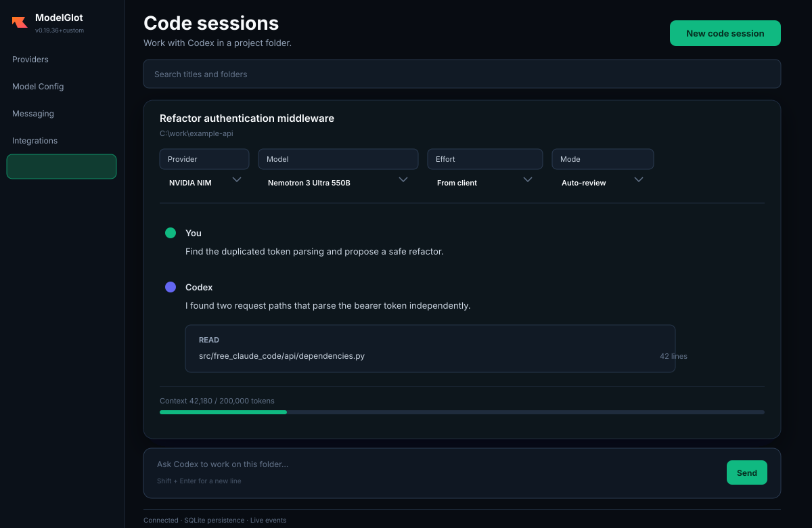

# Code Sessions

Status: implemented
Scope: `modelglot` on branch `custom/main`, aligned on 2026-11-17
Audience: users and maintainers

Code sessions provide a browser-based workspace for running Codex through ModelGlot.
They combine ModelGlot's provider and model configuration with Codex's native session, tool, and
permission behavior.



## Requirements

- ModelGlot must be running on the computer that owns the project folder.
- Codex must be installed and available on `PATH`:
  ```bash
  npm install -g @openai/codex
  ```
- At least one provider and model must be configured in **Admin UI → Model Config**.

The Code sessions tab remains available when Codex is missing and shows the installation
instruction. ModelGlot does not bundle or install Codex automatically.

## Open a session

1. Start ModelGlot and open the Admin UI.
2. Select **Code sessions**.
3. Click **New code session**.
4. Browse to an existing project folder, or enter its absolute path manually.
5. Create the session, choose a provider/model and reasoning effort, then send a prompt.

Only an existing folder can be selected. The folder path identifies the working directory
that Codex receives for the session.

## Session controls

| Control | Behavior |
| --- | --- |
| Provider | Selects the provider used by the session's model catalog. |
| Model | Selects a model discovered by ModelGlot. The selected model is passed to Codex. |
| Effort | Selects a reasoning effort supported by the selected model. |
| Mode | Selects the Codex permission mode for the session. |
| Send | Submits the prompt and starts a turn. |
| Stop | Requests cancellation of the active turn. |
| Delete | Removes the ModelGlot session and its native Codex conversation. |

The header also shows the current context occupancy when Codex reports it and the model
context window is known. ModelGlot does not infer an unknown context limit.

## Permission modes

| Mode | Behavior |
| --- | --- |
| **Use config** | Uses the permission selection configured for the native Codex session. |
| **Ask** | Requests approval for actions that require it. |
| **Auto-review** | Uses Codex's automatic review behavior. |
| **Full access** | Gives the session the broadest Codex access mode. |

The mode is stored per session. A user should choose **Full access** only for a project and
provider they trust.

## Persistence and live updates

ModelGlot stores session metadata, turns, transcript items, prompts, and revisions in its local
SQLite database. Active runs interrupted by a restart are recovered as interrupted turns;
pending permission prompts are recovered as expired prompts.

The browser receives state through a Server-Sent Events stream. If the event stream
overflows, ModelGlot asks the client to resynchronize and reloads the current snapshot.

## Admin API

The Admin API is loopback-only and intended for the local Admin UI:

| Endpoint | Purpose |
| --- | --- |
| `GET /admin/api/code/bootstrap` | Availability, storage state, harness list, and model catalog. |
| `POST /admin/api/code/folder-picker` | Opens the native folder picker. |
| `GET /admin/api/code/sessions` | Paginated session library, searchable by title and folder. |
| `POST /admin/api/code/sessions` | Creates a session for a project folder. |
| `GET /admin/api/code/sessions/{id}` | Session, runs, transcript items, and pending prompts. |
| `GET /admin/api/code/sessions/{id}/items` | Paginated transcript items. |
| `PATCH /admin/api/code/sessions/{id}` | Updates model, effort, title, or permission mode. |
| `DELETE /admin/api/code/sessions/{id}` | Deletes the ModelGlot session and native conversation. |
| `POST /admin/api/code/sessions/{id}/turns` | Submits a prompt. |
| `POST /admin/api/code/sessions/{id}/stop` | Stops the active turn. |
| `POST /admin/api/code/sessions/{id}/prompts/{prompt_id}/responses` | Answers a pending permission prompt. |
| `GET /admin/api/code/events` | Live event stream for the Code sessions UI. |

These endpoints use optimistic revisions: writes include the revision last observed by the
client, so conflicting edits are rejected instead of silently overwriting newer state.

## Verification

Focused tests cover the Admin routes, browser UI, SQLite persistence, recovery, Codex
harness integration, and the public feature contract:

```bash
uv run pytest -q tests/api/test_code_sessions_routes.py tests/application/test_code_sessions.py tests/application/test_code_sessions_state.py tests/runtime/test_code_sessions_sqlite.py tests/runtime/test_codex_app_server.py
```

## Current limitations

- Codex is the only Code sessions harness currently exposed by the bootstrap contract.
- A native conversation that no longer exists in Codex storage cannot be recovered by ModelGlot.
- Deleting a session requires Codex to remove its native conversation.
- Code sessions use the local Admin surface and are not a remote multi-user service.
